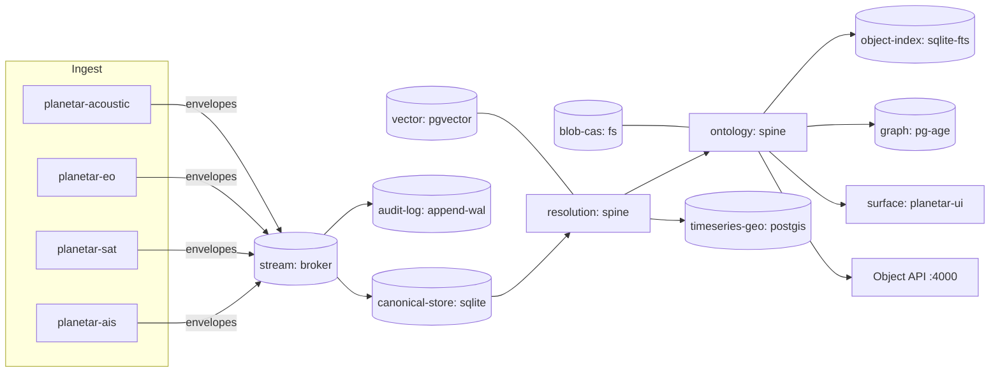

# 13 — Client Manifest

The manifest is the **single declarative artifact that defines a client's architecture**: which capabilities are enabled, which engine fills each storage role, how they connect, what governance applies, and where it deploys. It is versioned in the [registry (R10)](./10-STORAGE-ROLES.md) and **compiled** ([`12 §4`](./12-ADAPTER-CONTRACT.md)) into a running platform.

"Each client a different architecture" = each client a different manifest. Nothing else forks.

---

## 1. Manifest shape

```yaml
# manifest.yaml — schema_version pins the compiler contract
schema_version: "1.0"

client:
  id: planetar-maritime           # stable slug
  name: "Maritime / Defence (planetar)"
  tier: edge                       # edge | standard | scale | air-gapped  (sets contract defaults)

# 1) WHAT the client does — capability keys from 20-PARITY-MATRIX/.
#    The compiler unions their role footprints (11 §3) to compute required roles.
capabilities:
  - streaming-ingestion
  - identity-resolution
  - kinetic-writes
  - dark-vessel-reid
  - geotemporal
  - link-analysis
  - media-sets
  - audit
  # NOT enabled here: reporting-olap, agents-rag, crm-pipeline → those roles never bind

# 2) HOW — bind each required role to an engine + connection config.
#    The compiler errors if a required role (from capabilities above) is missing,
#    or if an engine's declared capabilities don't satisfy the role contract.
roles:
  canonical-store:
    engine: sqlite
    config: { path: ./data/canonical.db }
  stream:
    engine: broker                 # the native ns bus; envelope = zmesg
    config: { pub: 12001, sub: 12002, udp: 12003, wal: ./wal }
  object-index:
    engine: sqlite                 # sqlite FTS5 — no separate search service at the edge
    config: { path: ./data/canonical.db, fts: true }
  graph:
    engine: postgres-age           # one small pg for graph; or 'falkordb'
    config: { connection: { host: 127.0.0.1, db: graph } }
  blob-cas:
    engine: filesystem
    config: { root: ./blobs }
  timeseries-geo:
    engine: postgis
    config: { connection: { host: 127.0.0.1, db: tracks } }
  vector:
    engine: pgvector               # rides the same postgis pg
    config: { connection: { host: 127.0.0.1, db: tracks }, dim: 512 }
  audit-log:
    engine: append-wal
    config: { path: ./audit }
  registry:
    engine: git-fs
    config: { path: ./registry }
  policy-identity:
    engine: internal               # edge: no Keycloak; local principals + embedded OPA bundle
    config: { policyBundle: ./policy }
  work-queue:
    engine: sqlite
    config: { path: ./data/work.db }
  # hot-cache omitted → compiler binds the default in-process LRU (no capability requires durable cache)

# 3) Ingest — connectors/detectors active for this client (P2).
ingest:
  - { kind: detector, name: planetar-ais,      areas: [victoria, hormuz] }
  - { kind: detector, name: planetar-sat,      mode: replay }
  - { kind: detector, name: planetar-eo,       sources: victoria-webcams }
  - { kind: detector, name: planetar-acoustic, source: synth }

# 4) Surfaces — what users/agents touch (P8).
surfaces:
  - { kind: shell, name: planetar-ui, panes: [map, graph, channels, imagery] }
  - { kind: object-api, port: 4000 }

# 5) Governance (P1) — markings + propagation + audit sink.
governance:
  markings:
    - { id: UNCLASS, default: true }
    - { id: OPS-RESTRICTED }
  propagate: lineage               # markings flow along R12 lineage edges
  audit: { sink: audit-log, export: none }

# 6) Deploy (P0).
deploy:
  target: pm2                      # pm2 | kubernetes | nomad | apollo-style
  host: bb
  notes: "fully offline-capable; no external services required"
```

---

## 2. What the compiler validates

```
manifest.yaml
  └─ parse + schema_version check
      └─ resolve capabilities → required-roles (union of footprints, 11 §3)
          ├─ ✗ error: a required role is unbound
          ├─ ✗ error: a bound engine has no adapter in the binder registry (12 §4)
          ├─ ✗ error: adapter.capabilities ⊅ ROLE_CONTRACT[role]   (e.g. eventual cache for a strong role)
          ├─ ✗ error: a collapse is illegal (e.g. R3 bound to in-proc but a consumer needs durable replay)
          ├─ ⚠ warn:  an enabled capability's *enhancing* role is unbound (degraded, not broken)
          └─ ✓ emit ResolvedManifest → binder.bind() → BoundPlatform
```

Two consequences worth calling out:

- **You can't under-provision silently.** Enabling `agents-rag` without binding `vector` (R7) is a compile error, not a 3am incident.
- **You can't over-provision by habit.** Roles with no enabling capability are never bound — the maritime manifest above runs **zero** of opensearch/clickhouse/kafka/redis because nothing it enabled needs them.

---

## 3. The same client, scaled up (one diff)

To take the maritime client from edge to a regional cloud deployment, you change **bindings**, not capabilities or code:

```diff
 client:
-  tier: edge
+  tier: scale
 roles:
   canonical-store:
-    engine: sqlite
-    config: { path: ./data/canonical.db }
+    engine: postgres
+    config: { connection: { host: db.internal, db: canonical, pool: 20 } }
   object-index:
-    engine: sqlite
-    config: { path: ./data/canonical.db, fts: true }
+    engine: opensearch
+    config: { nodes: [os1.internal, os2.internal] }
   stream:
-    engine: broker
-    config: { pub: 12001, sub: 12002, udp: 12003, wal: ./wal }
+    engine: broker                 # keep ns broker at the edge nodes...
+    config: { pub: 12001, sub: 12002, bridgeTo: kafka }   # ...bridged to kafka for cloud retention
   blob-cas:
-    engine: filesystem
+    engine: minio
+    config: { endpoint: s3.internal, bucket: planetar-media }
 deploy:
-  target: pm2
+  target: kubernetes
```

The ontology, resolver, Object API, detectors, and UI are byte-for-byte identical across both manifests. That is the product.

---

## 4. Manifest → topology diagram

The compiler can emit a Mermaid topology from any manifest (handy for client docs and the `30-CLIENTS/` reference architectures):



---

## 5. JSON-Schema for the manifest (excerpt)

The manifest is itself a registered `core:SchemaType`, so it's validated and versioned like any other entity.

```jsonc
{
  "$id": "planetar:ClientManifest",
  "type": "object",
  "required": ["schema_version", "client", "capabilities", "roles"],
  "properties": {
    "schema_version": { "const": "1.0" },
    "client": {
      "type": "object",
      "required": ["id", "tier"],
      "properties": {
        "id":   { "type": "string", "pattern": "^[a-z0-9-]+$" },
        "tier": { "enum": ["edge", "standard", "scale", "air-gapped"] }
      }
    },
    "capabilities": { "type": "array", "items": { "$ref": "#/$defs/capabilityKey" } },
    "roles": {
      "type": "object",
      "additionalProperties": false,
      "patternProperties": {
        "^(canonical-store|hot-cache|stream|object-index|graph|blob-cas|vector|timeseries-geo|analytics-olap|registry|audit-log|lineage|policy-identity|work-queue)$": {
          "type": "object",
          "required": ["engine"],
          "properties": { "engine": { "type": "string" }, "config": { "type": "object" } }
        }
      }
    }
  }
}
```

---

The four worked client manifests — maritime (above, expanded), biotech CRM, generic enterprise, intel/financial-crime — each with full bindings, topology, and capability coverage, live in `30-CLIENTS/`.
