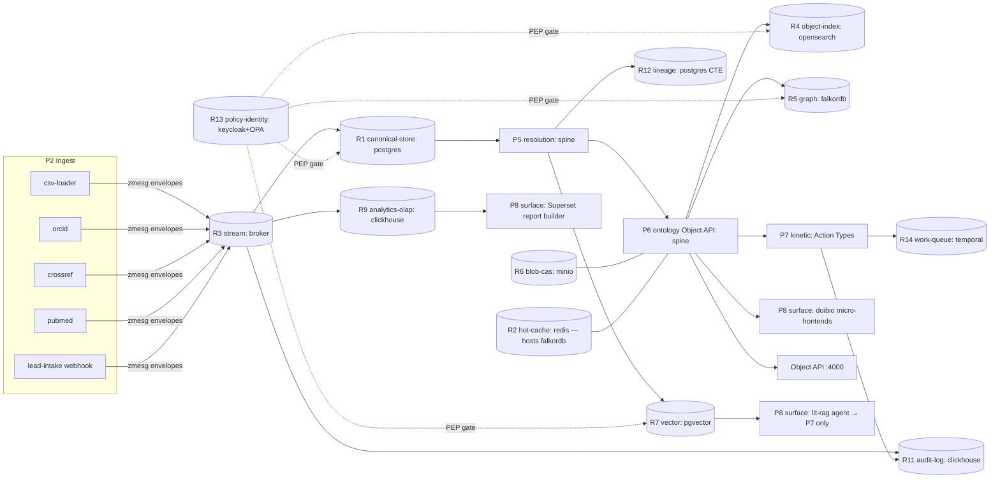

# 30 — Reference Client · Biotech / Research CRM (`doibio`)

> One of the four reference topologies in [`30-CLIENTS/`](./). Same spine ([`00`](../00-ARCHITECTURE-OVERVIEW.md)), same 14 roles ([`10`](../10-STORAGE-ROLES.md)), same ports ([`12`](../12-ADAPTER-CONTRACT.md)) — a **different manifest** ([`13`](../13-CLIENT-MANIFEST.md)). This one is the **Salesforce-leaning** anchor: a metadata-driven CRM for life-science research, built on the donor `~/data/dev/doibio`.

Status legend: **built** · **partial** · **designed** · **planned** (per [`README`](../README.md)). Roles **R1..R14** and planes **P0..P8** are used verbatim from the spine.

---

## 1. Who the client is, and the headline architecture story

The biotech/research CRM is a **Salesforce-for-biology**: research orgs (pharma, biotech, academic labs, CROs) tracking **researchers, organizations, publications, grants, leads, opportunities, and the collaboration graph that connects them**. The donor `doibio` is already a working, narrow Salesforce clone — **18 JSON-schema custom objects** in its vault (`Account`, `Contact`, `Lead`, `Opportunity`, `Case`, `Campaign`, `Quote`, `Party`, `PartyIdentification`, `ResearcherProfile`, `Knowledge`, …; the broader 35-schema set spans the app-specific micro-frontends), an **event-sourced vault→SQLite store** (37 tables), **~120 REST routes**, **~20 React micro-frontends**, immutable event-log audit, CSV import/export, webhooks, Elasticsearch search, and Cohere AI chat. The headline story is that **doibio's event-sourced vault *is* the platform's P3 stream + P4 canonical store in miniature**: every record change is already an append-only event that projects into the SQLite read model — exactly the [`00 §4.1`](../00-ARCHITECTURE-OVERVIEW.md) ingest→entity lifecycle, just running on one box. Lift that vault onto the bus (`zmesg` envelope + `planetar-broker` for R3) and the SQLite read model onto a **postgres** canonical store (R1), and doibio's hand-rolled CRM becomes a *manifest binding* of the general platform — at which point the spine's identity resolution (the moat, donated *from* this very repo's `identity-resolution.ts`), kinetic Action Types, propagating governance, and graph/vector/OLAP roles all drop in without rewriting a single React app. This doc shows that binding: a **standard single-cloud manifest** (postgres / redis / opensearch / falkordb / minio / pgvector), the capability coverage, and the three doibio gaps that must close for true Salesforce parity — a **declarative Flow engine** (R14 + Temporal), **FLS / row-level sharing** (R13 OPA), and a **drag-drop report builder** (R9).

---

## 2. Enabled capabilities → role footprints (the union)

The client enables nine capability keys (drawn from [`20-PARITY-MATRIX/salesforce-*`](../20-PARITY-MATRIX/) and the footprints in [`11 §3`](../11-CAPABILITY-ROLE-MAP.md)). The manifest compiler **unions** their required-role footprints to compute the required engine set. **Required** roles bold; *enhancing* roles italic.

| Capability key | What it gives the research CRM | Required (**bold**) + *enhancing* roles |
|---|---|---|
| `crm-objects` | Standard + custom objects (Org, Researcher, Publication, Lead, Opportunity, Grant) with CRUD via the Object API | **R1**, **R10**, **R3**, *R4* |
| `custom-fields` | Typed declarative fields (picklist research-area, ORCID, formula h-index) | **R1**, **R10** |
| `identity-resolution` | Dedup/merge researchers & orgs across sources; golden profile; per-field provenance | **R1**, **R4**, **R12**, *R7* |
| `reporting-olap` | Pipeline/grant/publication roll-ups; report builder over fact tables | **R9**, **R1**, *R4* |
| `automation-flow` | Declarative trigger→action flows (lead→opportunity, consent expiry, enrichment) | **R14**, **R1**, **R3**, *R13* |
| `audit` | Immutable record of every read/write/export/AI action (Shield-class) | **R11** |
| `search` | Global full-text + filtered list views over all objects; semantic literature match | **R4**, **R1**, *R7*, *R2* |
| `link-analysis` | Collaboration graph: Researcher↔Org↔Publication↔Grant traversal, co-authorship rings | **R5**, **R1**, *R4* |
| `agents-rag` | Literature RAG agent grounded on indexed publications; contained by P7 | **R7**, **R6**, **R10**, *R5* |

**Union of required roles (the client's engine set):**

```
crm-objects          = {R1, R10, R3}           (+R4)
custom-fields        = {R1, R10}
identity-resolution  = {R1, R4, R12}           (+R7)
reporting-olap       = {R9, R1}                 (+R4)
automation-flow      = {R14, R1, R3}           (+R13)
audit                = {R11}
search               = {R4, R1}                 (+R7, R2)
link-analysis        = {R5, R1}                 (+R4)
agents-rag           = {R7, R6, R10}            (+R5)
──────────────────────────────────────────────────────
UNION (required)     = R1, R3, R4, R5, R6, R7, R9, R10, R11, R12, R14
ENHANCING (bound)    = R2  (presence + decision cache + hot cards)
NOT REQUIRED         = R8  (timeseries-geo) — no high-freq sensor/track lane in a research CRM;
                            R13 is enhancing-only at MVP, bound to close the FLS/sharing gap (§7)
```

Eleven required roles + R2/R13 bound, **R8 never binds** — a research CRM has no AIS/SAR/telemetry firehose, so the manifest compiler ([`13 §2`](../13-CLIENT-MANIFEST.md)) confirms no enabled capability needs timeseries-geo and leaves it out. That is the same selectivity that lets the maritime edge skip R9: *bind only what a capability requires.*

---

## 3. The manifest

A research CRM is a **single-cloud SaaS** — there is no edge/air-gapped variant the way maritime has (that two-manifest pattern is for the sensor-fusion client). So this client ships **one** standard manifest, exactly the "Standard (single-cloud SaaS)" collapse from [`10 §3`](../10-STORAGE-ROLES.md): **one postgres multiplexes R1 + small-R12 + R14**, **opensearch** takes R4 at search volume, **falkordb** rides the redis already bound for R2 to serve R5, **pgvector** (an extension on the same postgres) serves R7, **minio** serves R6, **clickhouse** serves R9, and **temporal** + **OPA** back the two parity gaps.

```yaml
# 30-CLIENTS/biotech-research-crm/manifest.yaml
schema_version: "1.0"

client:
  id: doibio-research-crm
  name: "Biotech / Research CRM (doibio)"
  tier: standard                     # single-cloud SaaS; sets standard contract defaults

# 1) WHAT — capability keys (20-PARITY-MATRIX/salesforce-*). Compiler unions footprints (11 §3).
capabilities:
  - crm-objects
  - custom-fields
  - identity-resolution
  - reporting-olap
  - automation-flow
  - audit
  - search
  - link-analysis          # collaboration graph
  - agents-rag             # literature RAG
  # NOT enabled: geotemporal, dark-vessel-reid, media-sets(maritime), streaming-sensor
  #   → R8 never binds; those roles stay cold for this client.

# 2) HOW — bind each required role to an engine + connection config.
roles:
  canonical-store:                   # R1 — the system-of-record projection
    engine: postgres                 # replaces doibio's vault→SQLite read model
    config:
      connection: { host: pg.internal, db: crm, user: planetar, pool: 20 }
      # one pg also serves R12 (recursive-CTE lineage) + R14 (skip-locked queue)

  stream:                            # R3 — the bus; doibio's event-sourced vault lands here
    engine: broker                   # zmesg envelope + planetar-broker (SHM/TCP/UDP/WAL)
    config: { pub: 12001, sub: 12002, wal: ./wal, bridgeTo: none }

  object-index:                      # R4 — Einstein-Search-class FTS/filter/facet
    engine: opensearch               # replaces doibio's Elasticsearch es-app
    config: { nodes: [os1.internal, os2.internal], index_prefix: crm }

  graph:                             # R5 — the collaboration graph
    engine: falkordb                 # Redis-module: rides the R2 redis, one fewer service than neo4j
    config: { host: redis.internal, port: 6379, graph: collab }

  blob-cas:                          # R6 — publication PDFs, attachments, figures
    engine: minio
    config: { endpoint: s3.internal, bucket: doibio-content, region: us-east-1 }

  vector:                            # R7 — semantic literature match + fuzzy identity
    engine: pgvector                 # extension on the SAME pg as R1 — no extra service
    config: { connection: { host: pg.internal, db: crm }, dim: 1024 }   # Cohere embed-v3 = 1024

  analytics-olap:                    # R9 — report builder + pipeline/grant roll-ups
    engine: clickhouse               # closes the canned-SQL-only gap (doibio analytics-app)
    config: { url: http://ch.internal:8123, db: crm_analytics }

  registry:                          # R10 — SSOT for the 35 object/field/link/action defs
    engine: git-fs
    config: { path: ./registry }     # git-vault SSOT + compiled in-memory copy (no I/O on data path)

  audit-log:                         # R11 — immutable read/write/export/AI record
    engine: clickhouse               # queryable SIEM feed; doibio event-log is the substrate
    config: { url: http://ch.internal:8123, db: crm_audit, table: audit_events }

  lineage:                           # R12 — per-field provenance → marking propagation carrier
    engine: postgres                 # recursive-CTE lineage on the SAME pg as R1 (small scale)
    config: { connection: { host: pg.internal, db: crm }, table: lineage_edges }

  policy-identity:                   # R13 — FLS + row-level sharing (the parity gap, §7)
    engine: keycloak-opa
    config:
      realm: doibio
      keycloakUrl: https://auth.internal
      opaUrl: http://opa.internal:8181      # default-deny Rego bundle (FLS + OWD + sharing)

  hot-cache:                         # R2 — presence, decision cache, hot object cards
    engine: redis                    # also hosts the falkordb R5 graph module
    config: { host: redis.internal, port: 6379, db: 0 }

  work-queue:                        # R14 — declarative Flow runtime (the parity gap, §7)
    engine: temporal                 # durable multi-step orchestration (lead→opp, approvals)
    config: { address: temporal.internal:7233, namespace: doibio, taskQueue: flows }
    # NOTE: simple one-shot async jobs fall back to postgres SKIP-LOCKED on the R1 pg;
    #       temporal is bound because automation-flow needs durable long-running orchestration.
  # R8 timeseries-geo omitted → no enabled capability requires it; compiler leaves it unbound.

# 3) Ingest — connectors/detectors active for this client (P2).
ingest:
  - { kind: import,    name: csv-loader,    sources: [salesforce-export, crm-csv] }   # doibio import-export.ts
  - { kind: connector, name: orcid,         mode: enrich }      # researcher identity enrichment
  - { kind: connector, name: crossref,      mode: poll }        # publications → Publication objects
  - { kind: connector, name: pubmed,        mode: poll }        # literature corpus → blob + embed
  - { kind: webhook,   name: lead-intake,   path: /hooks/lead } # web-to-lead (doibio webhooks.ts)

# 4) Surfaces — what users/agents touch (P8).
surfaces:
  - { kind: shell,      name: doibio-mfe,  apps: [contact, party, leads, tables, graph, analytics, search] }
  - { kind: object-api, port: 4000 }                  # ontology REST + WS (OSDK-equivalent)
  - { kind: bi,         name: superset,    source: analytics-olap }   # report builder over R9
  - { kind: agent,      name: lit-rag,     grounding: vector, contained_by: kinetic }

# 5) Governance (P1) — markings + propagation + audit sink.
governance:
  markings:
    - { id: PUBLIC,       default: true }
    - { id: PII }                    # consent-scoped contact data (ContactPointConsent / DataUsePurpose)
    - { id: COMMERCIAL-CONFIDENTIAL }
  propagate: lineage                 # markings flow along R12 lineage edges to derived stores
  fls: opa                           # field-level security enforced by adapters-as-PEP via OPA
  sharing: opa                       # row-level / OWD sharing decided by OPA (the gap, §7)
  audit: { sink: audit-log, export: splunk }

# 6) Deploy (P0).
deploy:
  target: kubernetes
  host: www0
  notes: "single-cloud SaaS; one postgres multiplexes R1+R12+R14-fallback; redis hosts falkordb R5"
```

The compiler validates ([`13 §2`](../13-CLIENT-MANIFEST.md)): every required role from §2 is bound; no engine's declared `capabilities` violates its role contract (e.g. it would **reject** binding R1 to an `eventual` cache, or R11 to a `rebuildable` engine — audit must never be re-derived); and the collapses are legal (pg simultaneously satisfying R1+R12+R14-fallback, redis hosting both R2 and the falkordb R5 module).

---

## 4. Topology (emitted from the manifest)



R8 (timeseries-geo) is absent from the diagram — the compiler never bound it. The dotted `PEP gate` edges are the [`governance §3`](../40-ADAPTERS/governance.md) invariant: **every storage adapter is a Policy Enforcement Point** that calls the OPA PDP before returning rows, which is how FLS/sharing (§7) becomes enforceable without a "security service" the apps must remember to call.

---

## 5. Capability-coverage table

Feature → required roles → bound engine → status → reuse vs net-new. Statuses follow the donor inventory: doibio is **built** for the CRM core, **partial** for search/analytics/governance substrate, and the three named gaps are **designed**.

| Feature (capability) | Required roles | Bound engine(s) | Status | Reused vs net-new |
|---|---|---|---|---|
| Standard + custom objects (`crm-objects`) | R1, R10, R3 | postgres, git-fs, broker | **built** | **reuse:** doibio 18 vault schemas + the 35-schema app set, `planetar-ontology` object types. **net-new:** project doibio's vault events onto the bus instead of straight to SQLite |
| Custom fields / picklists / formula (`custom-fields`) | R1, R10 | postgres, git-fs | **built** (basic) / **partial** (formula) | **reuse:** doibio JSON-Schema field defs → columns; `planetar-registry` codegen slice. **net-new:** formula-field DSL (ontology Function) |
| Identity resolution / golden profile (`identity-resolution`) | R1, R4, R12, *R7* | postgres, opensearch, postgres-CTE, pgvector | **built** | **reuse:** `doibio/src/lib/identity-resolution.ts` (630 LOC) → ported into `planetar-ontology/src/resolve/`; per-field provenance. **net-new:** opensearch blocking at scale + pgvector fuzzy/visual |
| Collaboration graph (`link-analysis`) | R5, R1, *R4* | falkordb, postgres | **built/partial** | **reuse:** doibio `graph-app/`, ontology link types & `getLinks`. **net-new:** falkordb projection from R1 links (run projector from offset 0) |
| Global + semantic search (`search`) | R4, R1, *R7*, *R2* | opensearch, postgres, pgvector, redis | **partial** | **reuse:** doibio Elasticsearch `es-app/`, Cohere chat. **net-new:** spine `ObjectIndex` port on opensearch + pgvector hybrid re-rank |
| Audit / Shield Event Monitoring (`audit`) | R11 | clickhouse | **built** (write) / **partial** (read/export) | **reuse:** doibio immutable event-log (`src/lib/event-log.ts`), ontology action audit. **net-new:** read/export-event instrumentation + clickhouse SIEM sink |
| Reports & dashboards / builder (`reporting-olap`) | R9, R1, *R4* | clickhouse, postgres | **partial** → **designed** (builder) | **reuse:** doibio `analytics-app/` canned SQL + `metrics.ts` redis rollup. **net-new:** clickhouse fact tables + Superset drag-drop builder (**GAP**, §7) |
| Literature RAG agent (`agents-rag`) | R7, R6, R10, *R5* | pgvector, minio, git-fs, falkordb | **partial** → **designed** | **reuse:** doibio Cohere chat (read-only precursor). **net-new:** kinetic-contained agent (writes via P7 only), pgvector grounding over minio corpus |
| **Declarative Flow engine** (`automation-flow`) | R14, R1, R3, *R13* | temporal, postgres, broker, OPA | **designed** (**GAP**) | **reuse:** doibio `webhooks.ts` (only automation today), ontology Action Type executor as substrate. **net-new:** Temporal-backed flow runtime + visual trigger→action builder |
| **FLS / row-level sharing** (governance) | R13, R1, *R12* | keycloak-opa, postgres | **designed** (**GAP**) | **reuse:** doibio `keycloak/` (authn only), adapters-as-PEP design. **net-new:** OPA default-deny Rego for FLS + OWD + sharing; doibio has *neither* today |
| Markings + propagation (governance) | R12, R13, R11 | postgres-CTE, OPA, clickhouse | **designed** | **reuse:** per-field `provenance` in canonical model. **net-new:** marking propagation along lineage (spine rules) |

---

## 6. Client-specific sample code (against the real ports)

All three snippets import **only** the role-port interfaces from [`12-ADAPTER-CONTRACT.md`](../12-ADAPTER-CONTRACT.md) — never an engine driver. The `BoundPlatform` from [`12 §4`](../12-ADAPTER-CONTRACT.md) hands them the bound adapter per role, so the *same code* runs whether R1 is the standard `postgres` or, for a tiny single-lab deployment, `sqlite`.

### 6.1 Action Type — `MergeResearchers` (P7 kinetic write, the only write path)

The identity resolver *proposes* a merge; a human or the lit-agent *commits* it through this Action Type, so the merge is precondition-checked, audited (R11), provenance-stamped (R12), and reversible. This is doibio's `shouldMergeParties` / `MatchResult.suggested_action: 'merge'` lifted onto the kinetic plane.

```ts
// 30-CLIENTS/biotech-research-crm/actions/merge-researchers.ts
import type { CanonicalStore, Tx } from '../../../spine/ports/canonical-store';
import type { Stream } from '../../../spine/ports/stream';
import type { GraphStore } from '../../../spine/ports/graph-store';
import type { ActionContext, ActionOutcome } from '../../../spine/ports/kinetic';
import { Envelope } from '../../../spine/model';

/**
 * MergeResearchers — fold a duplicate Researcher (loser) into the golden one (winner).
 * Survivorship is per-field (R12 provenance); the loser becomes a `same_party` link, never deleted.
 * Engine-agnostic: store may be postgres or sqlite; graph may be falkordb or neo4j.
 */
export async function mergeResearchers(
  ctx: ActionContext,
  params: { winnerId: string; loserId: string; justification: string },
): Promise<ActionOutcome> {
  const store = ctx.platform.role<CanonicalStore>('canonical-store');
  const stream = ctx.platform.role<Stream>('stream');
  const graph = ctx.platform.role<GraphStore>('graph');

  // 1. precondition — both exist, are Researchers, are not already merged
  const [winner, loser] = await Promise.all([
    store.getEntity('doibio:Researcher', params.winnerId),
    store.getEntity('doibio:Researcher', params.loserId),
  ]);
  if (!winner || !loser) return { ok: false, error: 'precondition: researcher not found' };
  if ((loser.body as any).mergedInto) return { ok: false, error: 'precondition: loser already merged' };

  // 2. governance gate — R13 PEP via the adapter's MarkingResolver (default deny)
  const gate = await ctx.marking.can(ctx.principal, 'merge', 'doibio:Researcher', params.winnerId,
    [...(winner.markings ?? []), ...(loser.markings ?? [])]);
  if (!gate.allow) return { ok: false, error: `policy: ${gate.reason}` };

  // 3. effect — atomic survivorship + tombstone, one transaction (kinetic atomicity)
  await store.transaction(async (tx: Tx) => {
    const merged = survivorship(winner, loser);           // per-field winner, provenance carried (R12)
    await store.upsertEntity(merged, tx);
    await store.upsertEntity({ ...loser, body: { ...loser.body, mergedInto: params.winnerId } }, tx);
    await store.putLink({ type: 'doibio:same_party', fromId: params.loserId,
                          toId: params.winnerId, body: { confidence: 1.0, by: ctx.principal.id } }, tx);
  });

  // 4. the write IS an event (P3) — projects R4/R5/R7 + audit (R11) downstream, per 00 §4.2
  const env = Envelope.of('doibio:Researcher.merged', {
    winnerId: params.winnerId, loserId: params.loserId,
    justification: params.justification, principal: ctx.principal.id,
  }, { causationId: ctx.actionId });
  await stream.publish(env);
  await graph.upsertEdge({ id: env.uuid, type: 'doibio:same_party',
    from: params.loserId, to: params.winnerId, props: { confidence: 1.0 } });

  return { ok: true, effects: ['merged', 'tombstoned', 'linked', 'audited'], reversibleBy: env.uuid };
}
```

### 6.2 Domain query — the collaboration graph (R5 + R1, "search around" a researcher)

Gotham-style *Expand* over the research graph: from one researcher, traverse co-authorship and shared-grant edges two hops out, filtered to other researchers, exactly the `neighbors()` shape from [`12 §3`](../12-ADAPTER-CONTRACT.md). Identical call whether falkordb (this client) or neo4j is bound.

```ts
// 30-CLIENTS/biotech-research-crm/queries/collaborators.ts
import type { GraphStore, Subgraph } from '../../../spine/ports/graph-store';
import type { CanonicalStore } from '../../../spine/ports/canonical-store';

/** Two-hop collaboration neighborhood of a researcher: co-authors + shared-grant peers. */
export async function collaborationNeighborhood(
  platform: BoundPlatform, researcherId: string,
): Promise<{ subgraph: Subgraph; topCollaborators: { id: string; name: string; joint: number }[] }> {
  const graph = platform.role<GraphStore>('graph');
  const store = platform.role<CanonicalStore>('canonical-store');

  // R5 traversal — restrict to collaboration edge types, 2 hops, other researchers only
  const subgraph = await graph.neighbors(researcherId, {
    edgeTypes: ['doibio:co_authored', 'doibio:shared_grant'],
    direction: 'both',
    maxHops: 2,
    nodeFilter: { type: 'doibio:Researcher' },
    limit: 200,
    maxCostMs: 100,                 // R5 contract: p99 ≤ 100 ms bounded traversal
  });

  // rank by joint-edge weight (co-authorship count + shared grants), hydrate names from R1
  const weight = new Map<string, number>();
  for (const e of subgraph.edges) {
    if (e.from === researcherId || e.to === researcherId) {
      const peer = e.from === researcherId ? e.to : e.from;
      weight.set(peer, (weight.get(peer) ?? 0) + (Number((e.props as any).weight) || 1));
    }
  }
  const topCollaborators = await Promise.all(
    [...weight.entries()].sort((a, b) => b[1] - a[1]).slice(0, 10).map(async ([id, joint]) => {
      const r = await store.getEntity('doibio:Researcher', id);
      return { id, name: (r?.body as any)?.name ?? id, joint };
    }));

  return { subgraph, topCollaborators };
}
```

### 6.3 Connector — Crossref publications → resolver (P2 ingest, the donor's blocking step reused)

A connector pulls publications, emits one envelope per paper, and runs each author through the **spine identity resolver** — the `findMatchingParties` blocking-over-R4 logic donated *from* `identity-resolution.ts`. `co_authorship` is one of the donor's real `MatchReason` types, so the collaboration graph and the resolver share evidence.

```ts
// 30-CLIENTS/biotech-research-crm/connectors/crossref.ts
import type { Stream } from '../../../spine/ports/stream';
import type { ObjectIndex } from '../../../spine/ports/object-index';
import type { VectorStore } from '../../../spine/ports/vector';
import type { BlobCas } from '../../../spine/ports/blob-cas';
import { Envelope } from '../../../spine/model';
import { resolveParty } from '../../../spine/resolve';      // ported from doibio identity-resolution.ts

export async function ingestCrossref(platform: BoundPlatform, since: string): Promise<number> {
  const stream = platform.role<Stream>('stream');
  const index = platform.role<ObjectIndex>('object-index');   // R4 — blocking + search
  const vector = platform.role<VectorStore>('vector');        // R7 — semantic literature match
  const blob = platform.role<BlobCas>('blob-cas');            // R6 — PDF bytes never travel the bus

  let n = 0;
  for await (const work of crossrefWorks({ since })) {        // OSS connector lib (out of spine)
    // 1. PDF (if any) → R6, bus carries only the {sha256,size,mime} handle
    let pdfHandle;
    if (work.pdfBytes) pdfHandle = await blob.put(work.pdfBytes, 'application/pdf');

    // 2. one envelope per publication onto the bus (P3)
    const pubEnv = Envelope.of('doibio:Publication.observed', {
      doi: work.DOI, title: work.title, year: work.year, pdf: pdfHandle,
      authors: work.authors.map(a => ({ name: a.name, orcid: a.ORCID })),
    });
    await stream.publish(pubEnv);

    // 3. embed the abstract for semantic match / RAG grounding (R7)
    if (work.abstractEmbedding)
      await vector.upsert(`pub:${work.DOI}`, work.abstractEmbedding,
        { modality: 'text', type: 'doibio:Publication', doi: work.DOI, marking: 'PUBLIC' });

    // 4. resolve each author against existing researchers — blocking over R4 (the donor's logic)
    for (const author of work.authors) {
      const match = await resolveParty({ name: author.name, orcid: author.ORCID }, {
        index,                                  // candidate blocking via object-index (avoids O(n²))
        coAuthors: work.authors.map(a => a.name),   // 'co_authorship' MatchReason from doibio
      });
      // suggested_action 'merge'|'link'|'new'|'review' → propose a MergeResearchers action (§6.1),
      // never write directly: P7 kinetic is the only write path.
      await stream.publish(Envelope.of('doibio:Researcher.resolutionProposed',
        { name: author.name, orcid: author.ORCID, ...match }, { causationId: pubEnv.uuid }));
    }
    n++;
  }
  return n;
}
```

---

## 7. Reuse vs build

### Reused from `planetar-*` / `doibio` **unchanged** (wire in, don't rebuild)
- **Identity resolution (the moat).** `doibio/src/lib/identity-resolution.ts` (630 LOC: `findMatchingParties`, `shouldMergeParties`, `calculateFullNameSimilarity`, `MatchReason` incl. `co_authorship`) → already ported into `planetar-ontology/src/resolve/`. The research CRM is the *home turf* of this code.
- **The 35-schema object model.** doibio's vault schemas (Account, Contact, Lead, Opportunity, Case, Campaign, Quote, Party, ResearcherProfile, Knowledge, …) become the registry (R10) object/field/link defs — no remodeling.
- **Object API + OSDK-equivalent.** `planetar-ontology` REST+WS (`src/api/server.ts`, `ws.ts`) serves list/record/related-list/live-update for the **~20 React micro-frontends** (`contact-app/`, `party-app/`, `tables-app/`, `graph-app/`, `analytics-app/`, `search-app/`) — the surfaces ship as-is.
- **Bus + envelope.** `zmesg` + `planetar-broker` (R3); doibio's event-sourced vault (`src/lib/event-log.ts`) is the *pattern* that proves "every change is an event."
- **CSV import/export** (`doibio/src/lib/import-export.ts`), **webhooks** (`src/lib/webhooks.ts`), **Action Type executor** (`planetar-ontology/src/actions/executor.ts`).

### Net-new for this client (compose, mostly wiring)
- **Vault→bus→postgres projection.** doibio writes events straight to SQLite; the platform routes them through R3 then projects to the R1 `PostgresCanonicalStore` ([`12 §2.1`](../12-ADAPTER-CONTRACT.md)) — making the read model rebuildable and swappable.
- **falkordb R5 projection** of the collaboration graph from R1 links (run the projector from offset 0; no migration).
- **opensearch R4** + **pgvector R7 hybrid** replacing the standalone Elasticsearch `es-app`, behind the spine `ObjectIndex` / `VectorStore` ports.
- **clickhouse R9** fact tables for the report builder (replacing canned SQL) and **clickhouse R11** audit/SIEM sink.
- **Crossref/PubMed/ORCID connectors** (§6.3) and the **kinetic-contained literature RAG agent** (`agents-rag`).

### Gaps that must close for Salesforce parity (the named three)
1. **Declarative Flow engine — `automation-flow` (R14 + Temporal).** doibio's *only* automation is webhooks. The ontology Action Type executor is the imperative substrate; what's missing is the **Temporal-backed durable orchestration** (lead→opportunity conversion, consent-expiry, multi-step approvals) plus a **visual trigger→action authoring surface**. Bound to `temporal` in the manifest; status **designed**.
2. **FLS / row-level sharing — R13 OPA.** doibio has **neither** field-level security nor row-level sharing; `keycloak/` is authn-only. Closing it = an **OPA default-deny Rego bundle** (FLS + OWD + sharing rules) enforced by the **adapters-as-PEP** ([`governance §3`](../40-ADAPTERS/governance.md)) — every store (postgres, opensearch, falkordb, pgvector) calls the PDP before returning rows. Bound to `keycloak-opa`; status **designed**.
3. **Report builder — R9.** Reporting is **canned SQL only** (`analytics-app/` + a redis-sorted-set rollup in `metrics.ts`). Closing it = **clickhouse** fact tables (R9) + a **Superset** drag-drop report/dashboard builder over the object-set source. Bound to `clickhouse`; status **partial → designed**.

These three are the same gaps the [`salesforce-sales-service`](../20-PARITY-MATRIX/salesforce-sales-service.md) and [`salesforce-platform-data-ui`](../20-PARITY-MATRIX/salesforce-platform-data-ui.md) matrices flag for the whole Salesforce surface — surfacing them on the *built* CRM donor is what makes them concrete and schedulable rather than abstract. Everything below them — objects, fields, links, CRUD, identity resolution, audit substrate, search, graph — already cites a live repo.
