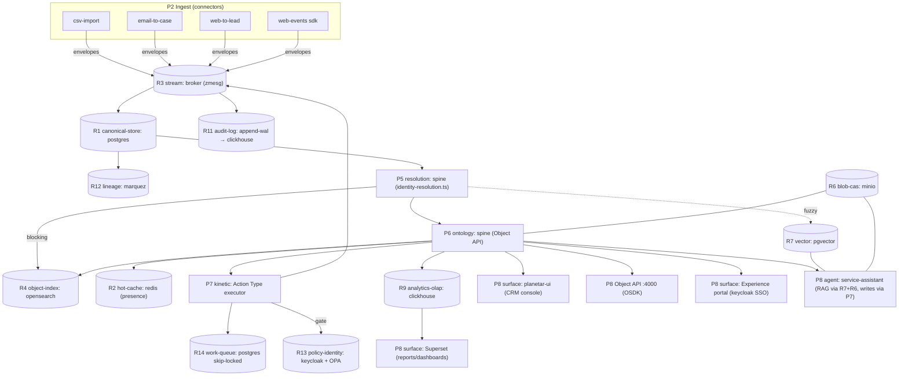

# 30 — Reference Client: Generic Enterprise CRM + Ops

**The "Salesforce replacement" reference.** A fresh commercial archetype — no maritime sensors, no defence markings, no biology schemas — that proves the platform composes into a clean, full-stack CRM. Where `planetar` (maritime) leans Gotham and `doibio` (biotech) leans Salesforce-narrow, **this client is the deliberate Salesforce-broad target**: Sales Cloud, Service Cloud, Data-Cloud-style identity + segmentation, Reports & Dashboards, Flow automation, an Experience-Cloud portal, and Agentforce-style agents — all presented as a CRM, all running on the **same ontology + kinetic spine** that surfaces as a link-chart for the intel client and a track-map for maritime.

> Status legend (this repo): **built** · **partial** · **designed** · **planned**. Roles use R1..R14 from [`10-STORAGE-ROLES.md`](../10-STORAGE-ROLES.md); planes P0..P8 from [`00-ARCHITECTURE-OVERVIEW.md`](../00-ARCHITECTURE-OVERVIEW.md); capability keys from [`20-PARITY-MATRIX/`](../20-PARITY-MATRIX/). Engine config shapes are verbatim from the [`40-ADAPTERS/`](../40-ADAPTERS/) chapters.

---

## 1. Who the client is + the headline architecture story

**Acme Corp** is a mid-market B2B company running Salesforce Sales Cloud + Service Cloud + Data Cloud today and wants out — for cost, data-residency, and the ability to bind its *own* warehouse instead of paying for Data-Cloud federation. They have leads/accounts/opportunities, a support contact-centre with omni-channel routing and a knowledge base, a self-service customer portal, marketing segmentation, and they want Agentforce-style assistants. **Nothing about their domain is special** — which is exactly the point: this client validates that the platform's CRM surface is generic, not a maritime artifact wearing a CRM costume.

**The architecture story in one line:** the *same* canonical model + ontology Object API (P6) that holds `planetar:Vessel` here holds `crm:Account`, `crm:Lead`, `crm:Opportunity`, `crm:Case`; the *same* kinetic Action Type executor (P7) that runs `ConfirmDarkVessel` here runs `ConvertLead`, `EscalateCase`, `RouteToAgent`, `ActivateSegment`; the *same* identity-resolution engine (P5) that does dark-vessel re-ID here does Data-Cloud golden-profile unification across CRM + web + support sources — **and the only thing that differs from maritime is the manifest**: postgres/spanner instead of sqlite for R1, opensearch instead of sqlite-FTS for R4, clickhouse bound for R9 (reporting, which maritime-edge never binds), keycloak+OPA bound for R13 (FLS/sharing, which maritime-edge runs `internal`), and the surface is a CRM shell + a portal instead of a track-map. Two manifests below show the **standard** (single-cloud, postgres-centric) and **scale** (spanner + kafka + clickhouse, multi-region) topologies — same spine, different bindings, zero application-code change.

---

## 2. Enabled capabilities → role-footprint union

The client enables thirteen capability keys. The compiler ([`11 §3`](../11-CAPABILITY-ROLE-MAP.md), [`13 §2`](../13-CLIENT-MANIFEST.md)) **unions their role footprints** to compute the required-role set, then collapses roles onto as few engines as each role's contract allows ([`10 §3`](../10-STORAGE-ROLES.md)).

**Required** roles in **bold**; *enhancing* roles in italic (degraded-not-broken if unbound).

| Capability key | Owning planes | Required + *enhancing* roles |
|---|---|---|
| `crm-objects` (standard/custom objects + CRUD) | P4, P6 | **R1**, **R10**, *R4* |
| `custom-fields` (typed fields, picklist, lookup, formula) | P4, P6 | **R1**, **R10** |
| `sales-pipeline` (leads/accounts/opps/stages/forecast) | P4, P6, P9 | **R1**, **R10**, **R9**, *R4* |
| `service-cases` (cases, knowledge, case feed) | P4, P6, P7 | **R1**, **R10**, **R3**, *R4*, *R7* |
| `omnichannel-routing` (queues + work distribution + presence) | P7, P8 | **R14**, **R2**, **R1** |
| `automation-flow` (Flow / approvals / record-triggered) | P7 | **R14**, **R1**, **R3**, *R13* |
| `reporting-olap` (reports + dashboards + CRMA) | P8, P9 | **R9**, **R1**, *R4* |
| `segmentation-activation` (audience builder + activation) | P6, P7, P8 | **R4**, **R1**, **R14**, **R3**, *R9* |
| `identity-resolution` (golden profile / Data Cloud unify) | P5 | **R1**, **R4**, **R12**, *R7* |
| `portal` (Experience Cloud self-service) | P8, P1 | **R1**, **R10**, **R13**, *R4* |
| `agents-rag` (Agentforce: RAG + tool-use) | P7, P8 | **R7**, **R6**, **R10**, **R1**, *R5* |
| `audit` (Shield Event Monitoring / Field Audit Trail) | P1 | **R11**, *R12* |
| `sso-rbac-fls` (profiles, permission sets, OWD, FLS, sharing) | P1 | **R13**, **R11**, *R12* |

### 2.1 The role-footprint union (required-role set for this client)

Stacking every **bold** role above and deduplicating:

```
union(required) = { R1, R2, R3, R4, R6, R7, R9, R10, R11, R12, R13, R14 }
not required    = { R5, R8 }
```

- **R5 (graph)** is only *enhancing* here (`agents-rag` can ground without graph traversal; CRM relationships are lookups on R1). The **scale** manifest binds it anyway (account-hierarchy "search around" + agent grounding); the **standard** manifest leaves it unbound and the compiler warns-not-errors. This is the inverse of the intel client, where R5 is the keystone.
- **R8 (timeseries-geo)** is **never required** — Acme has no sensor tracks. Salesforce-Maps-style geo would add it, but it's out of scope, so the compiler **never binds postgis/clickhouse-geo**. (Contrast: maritime binds R8 as a keystone.) This is the headline of [`11 §3`](../11-CAPABILITY-ROLE-MAP.md): *a client binds only the roles its capabilities require.*

So twelve of fourteen roles are live for a full Salesforce-parity CRM — but they **collapse onto a small engine set**: at standard tier, a single postgres multiplexes R1+R4(FTS)+R7(pgvector)+R9(small)+R12+R14 ([`relational.md §6`](../40-ADAPTERS/relational.md)), redis covers R2(+R3 streams alt), clickhouse covers R9 at scale, opensearch covers R4 at search volume, minio covers R6, keycloak+OPA cover R13, marquez covers R12, the broker covers R3+R11. **Five-to-nine engines, one spine.**

---

## 3. Manifests

Per the brief, two manifests are given for the maritime client. This generic-enterprise client is a **standard → scale** pair: the same thirteen capabilities, scaled from a single-cloud postgres-centric box to a multi-region spanner + kafka + clickhouse fleet by **changing bindings only**.

### 3.1 `manifest.standard.yaml` — single-cloud SaaS (postgres-centric)

```yaml
# manifest.yaml — Generic Enterprise CRM+Ops, STANDARD tier
schema_version: "1.0"

client:
  id: acme-crm
  name: "Acme Corp — Enterprise CRM + Ops (standard)"
  tier: standard                    # single-cloud SaaS; postgres multiplexes most roles

# 1) WHAT — capability keys (20-PARITY-MATRIX). Compiler unions footprints → required roles (§2.1).
capabilities:
  - crm-objects
  - custom-fields
  - sales-pipeline
  - service-cases
  - omnichannel-routing
  - automation-flow
  - reporting-olap
  - segmentation-activation
  - identity-resolution
  - portal
  - agents-rag
  - audit
  - sso-rbac-fls
  # NOT enabled: geotemporal, dark-vessel-reid, link-analysis(only enhancing) → R8 never binds, R5 left unbound (warn)

# 2) HOW — bind each required role. Standard tier collapses R1+R4+R7+R9(small)+R12+R14 onto ONE postgres.
roles:
  canonical-store:                  # R1 — the system-of-record projection
    engine: postgres                # 40-ADAPTERS/relational.md §2.2 (jsonb body, GIN, native upsert)
    config:
      connection: { host: db.internal, db: crm, user: crm, pool: 20 }
  hot-cache:                        # R2 — presence (omni-channel "who's online"), org cache, rate limits
    engine: redis                   # 40-ADAPTERS/cache-queue.md §2.3 (ioredis)
    config: { url: redis://cache.internal:6379, keyPrefix: "acme:" }
  stream:                           # R3 — Platform-Events/CDC equivalent; every state change is an envelope
    engine: broker                  # native zmesg bus; SHM+TCP+UDP+WAL
    config: { pub: 12001, sub: 12002, udp: 12003, wal: ./wal }
  object-index:                     # R4 — Einstein-Search/list-views + resolver BLOCKING step
    engine: opensearch              # 40-ADAPTERS/object-index.md — real search-360 at CRM query volume
    config: { nodes: [os1.internal, os2.internal], index_prefix: "acme-" }
  blob-cas:                         # R6 — Salesforce Files / attachments / knowledge media / RAG docs
    engine: minio                   # 40-ADAPTERS/blob-vector.md (s3-wire, presigned URLs)
    config: { endpoint: s3.internal, bucket: acme-files, region: us-east-1 }
  vector:                           # R7 — knowledge semantic match + agent RAG grounding
    engine: pgvector                # rides the SAME postgres as R1 (relational.md §6)
    config: { connection: { host: db.internal, db: crm }, dim: 1024 }   # 1024 = Cohere embed-v3
  analytics-olap:                   # R9 — reports/dashboards/forecast roll-ups/calculated-insights
    engine: clickhouse              # 40-ADAPTERS/timeseries-olap.md §R9 (columnar; report builder substrate)
    config: { url: http://olap.internal:8123, db: acme_analytics }
  registry:                         # R10 — Metadata-API/Custom-Metadata-Types SSOT
    engine: git-fs                  # 40-ADAPTERS/governance.md §R10 (PR-reviewed, SemVer, diffable)
    config: { path: ./registry }
  audit-log:                        # R11 — Shield Event Monitoring / Field Audit Trail / Setup Audit Trail
    engine: append-wal              # broker-style immutable append; export to SIEM
    config: { path: ./audit, export: clickhouse }   # also queryable via the R9 clickhouse
  lineage:                          # R12 — Data-Cloud lineage + the carrier for FLS/marking propagation
    engine: marquez                 # OpenLineage, postgres-backed (Monocle-class)
    config: { url: http://marquez.internal:5000 }
  policy-identity:                  # R13 — profiles/perm-sets/OWD/FLS/sharing + portal SSO; PEP at every adapter
    engine: keycloak+opa            # 40-ADAPTERS/governance.md §R13 (authn=keycloak, authz=OPA Rego, default-deny)
    config:
      keycloak: { url: https://id.acme.internal, realm: acme }
      opa: { url: http://opa.internal:8181, bundle: acme-crm-policy }
  work-queue:                       # R14 — Omni-Channel routing + Flow/approvals + segment activation jobs
    engine: postgres                # FOR UPDATE SKIP LOCKED; co-commits with the kinetic effect (cache-queue.md §1)
    config: { connection: { host: db.internal, db: crm }, table: work_queue }
  # graph (R5) deliberately UNBOUND — only enhancing for agents-rag here; compiler WARNS, capability degrades to non-graph RAG.

# 3) Ingest — connectors/detectors active (P2). No sensors; classic CRM source connectors.
ingest:
  - { kind: connector, name: csv-import,    via: doibio-import-export }      # built — doibio/src/lib/import-export.ts
  - { kind: connector, name: email-to-case, via: airbyte, source: imap }    # designed — connectors-at-breadth
  - { kind: connector, name: web-to-lead,   via: webform, endpoint: /ingest/lead }
  - { kind: connector, name: web-events,    via: js-sdk }                    # Data-Cloud-style web/mobile SDK ingest

# 4) Surfaces — what users/agents touch (P8).
surfaces:
  - { kind: shell, name: planetar-ui, profile: crm, panes: [list, record, console, reports] }  # 4-pane → CRM console
  - { kind: object-api, port: 4000 }                                          # OSDK-equivalent REST+WS
  - { kind: portal, name: experience-portal, audience: customer, auth: keycloak }  # Experience-Cloud parity
  - { kind: bi, name: superset, source: analytics-olap }                      # report/dashboard builder
  - { kind: agent, name: service-assistant, grounding: [vector, blob-cas], tools: kinetic }  # Agentforce parity

# 5) Governance (P1) — markings + propagation + audit sink.
governance:
  markings:
    - { id: PUBLIC, default: true }
    - { id: INTERNAL }
    - { id: CONFIDENTIAL }          # e.g. opportunity amounts, PII; gated by FLS/sharing via OPA
  propagate: lineage                # markings flow along R12 lineage edges to every derived store/surface
  audit: { sink: audit-log, export: siem }
  fls: { engine: opa, defaultDeny: true }   # field-level security + row-level sharing as OPA Rego

# 6) Deploy (P0).
deploy:
  target: kubernetes
  region: us-east-1
  notes: "single-region SaaS; postgres multiplexes R1+R7+R12+R14; opensearch + clickhouse + redis are the only extra stateful services."
```

### 3.2 `manifest.scale.yaml` — multi-region, planet-scale (the diff)

To take Acme from one region to global, multi-region, 99.999% — **capabilities and code are unchanged**; only bindings move ([`13 §3`](../13-CLIENT-MANIFEST.md), [`global-scale.md`](../40-ADAPTERS/global-scale.md)). Shown as a diff against §3.1:

```diff
 client:
-  tier: standard
+  tier: scale
 roles:
   canonical-store:
-    engine: postgres
-    config: { connection: { host: db.internal, db: crm, user: crm, pool: 20 } }
+    engine: spanner                 # global-scale.md — TrueTime, 99.999%, multi-region; SAME CanonicalStore port
+    config: { project: acme-prod, instance: crm, database: crm, shards: 256 }
   stream:
-    engine: broker
-    config: { pub: 12001, sub: 12002, udp: 12003, wal: ./wal }
+    engine: kafka                   # infinite retention + consumer groups; envelope still zmesg over the wire
+    config: { brokers: [k1.internal:9092, k2.internal:9092], topicPrefix: "acme." }
   vector:
-    engine: pgvector                # rode the postgres; spanner has no pgvector, so split it out
-    config: { connection: { host: db.internal, db: crm }, dim: 1024 }
+    engine: qdrant                  # dedicated vector service at agent-RAG scale
+    config: { url: http://qdrant.internal:6333, collection: acme-rag, dim: 1024 }
+  graph:                            # R5 now REQUIRED-by-choice: account hierarchy + agent "search around"
+    engine: neo4j                   # graph.md — mature Cypher + GDS for relationship ranking
+    config: { url: bolt://neo4j.internal:7687, db: acme }
   work-queue:
-    engine: postgres                # skip-locked co-commit was fine single-region...
-    config: { connection: { host: db.internal, db: crm }, table: work_queue }
+    engine: temporal                # ...but multi-region Flow orchestration + approvals + activation need durable sagas
+    config: { address: temporal.internal:7233, namespace: acme }
   audit-log:
-    engine: append-wal
-    config: { path: ./audit, export: clickhouse }
+    engine: kafka                   # stream audit straight to the client SIEM at scale
+    config: { brokers: [k1.internal:9092], topic: acme.audit, sink: siem }
 deploy:
-  region: us-east-1
+  regions: [us-east-1, eu-west-1, ap-southeast-2]
+  notes: "spanner multi-region; broker stays at edge ingest nodes bridged to kafka; clickhouse + opensearch + qdrant + neo4j sharded."
```

The ontology, resolver, identity-resolution, Object API, Action Type executor, detectors/connectors, the CRM shell, the portal, and every Action Type **are byte-for-byte identical across §3.1 and §3.2.** That invariance is the product.

---

## 4. Topology diagram (compiled from `manifest.standard.yaml`)

The compiler emits Mermaid from any manifest ([`13 §4`](../13-CLIENT-MANIFEST.md)). This is the **standard**-tier topology:



---

## 5. Capability-coverage table

Feature → required roles → bound engine (standard tier) → status → reuse vs net-new. Statuses + backing paths are taken verbatim from [`20-PARITY-MATRIX/salesforce-sales-service.md`](../20-PARITY-MATRIX/salesforce-sales-service.md) and [`salesforce-data-analytics-ai.md`](../20-PARITY-MATRIX/salesforce-data-analytics-ai.md).

| Feature | Required roles | Bound engine(s) | Status | Reused vs net-new |
|---|---|---|---|---|
| Standard/custom objects + CRUD | R1, R10 | postgres + git-fs | **built** | reuse `planetar-ontology` object types + `doibio` 35-schema donor; **net-new**: `crm:*` type defs in registry |
| Custom fields (text/picklist/lookup) | R1, R10 | postgres + git-fs | **built** | reuse `planetar-registry` codegen slice; net-new: formula-field eval is **partial** |
| Leads / accounts / contacts | R1, R10 | postgres | **built** | reuse `doibio` `leads-app`/`contact-app` + party schema as donor; net-new: `crm:` namespacing |
| Lead conversion (atomic multi-effect) | R10, R1, R11, R3 | git-fs + postgres + broker | **partial** | reuse Action Type executor (`planetar-ontology/src/actions/`); **net-new**: `ConvertLead` action (see §6.1) |
| Opportunities + stages | R1, R10, *R9* | postgres + clickhouse | **partial** | reuse object model donor; net-new: stage-transition Action Types |
| Pipeline / forecasting roll-ups | R1, R9 | postgres + clickhouse | **designed** | net-new: R9 clickhouse binding (unbound in every built client today) + forecast cube |
| Cases | R1, R10, *R4* | postgres + opensearch | **partial** | reuse object donor; net-new: case lifecycle + status model |
| Omni-Channel routing / queues | R14, R2, R1 | postgres-skiplocked + redis | **designed** | reuse `WorkQueue` port (`12 §3`); net-new: routing rules as Action Types, presence in redis |
| Knowledge base + semantic search | R1, R4, *R7* | opensearch + pgvector | **partial** | reuse `doibio` Elasticsearch (`es-app`) + Cohere chat; net-new: pgvector grounding |
| Case feed / chatter | R3, R1 | broker + postgres | **partial** | reuse `doibio` event-sourced feed + `comms-app` |
| Flow / automation / approvals | R14, R1, R3, *R13* | postgres + broker + OPA | **designed** | reuse Action Type executor as substrate; **net-new**: visual Flow engine (no declarative engine in any repo) |
| Reports + report builder | R9, R1, *R4* | clickhouse + Superset | **partial** | reuse `doibio` canned-SQL `analytics-app`; **net-new**: drag-drop builder over clickhouse/Superset |
| Dashboards | R9, R1 | clickhouse + Superset | **partial** | net-new: composable dashboard builder (doibio has fixed dashboards) |
| Segmentation (audience builder) | R4, R1, *R9* | opensearch + postgres | **partial** | reuse Object-API object sets; net-new: segment-builder UI |
| Activation (push segment to channels) | R14, R3, R1 | postgres + broker | **partial** | reuse activation-as-Action-Type (`executor.ts`); net-new: destination connectors (deferred) |
| Identity resolution / golden profile | R1, R4, R12, *R7* | postgres + opensearch + marquez | **built** | **reuse the moat**: `identity-resolution.ts` (631 LOC) → `planetar-ontology/src/resolve/`; net-new: CRM blocking keys (email/phone/domain) |
| List views / global search | R4, R1, *R7* | opensearch + pgvector | **built** | reuse `planetar-ontology` Object API list/filter + `doibio` `es-app` |
| Duplicate management / merge | R1, R4, R12 | postgres + opensearch + marquez | **built** | reuse identity-resolution engine (same code as golden profile) |
| CSV import / data loader | R1, R3 | postgres + broker | **built** | **reuse unchanged**: `doibio/src/lib/import-export.ts` |
| Webhooks / outbound messages | R3, R14 | broker + postgres | **built** | **reuse unchanged**: `doibio/src/lib/webhooks.ts` (the only built automation) |
| Experience-Cloud portal | R1, R10, R13, *R4* | postgres + git-fs + keycloak | **partial** | reuse Object API + `doibio` ~20 React micro-frontends + `keycloak/`; net-new: external-audience FLS scoping |
| Agentforce-style agents (RAG + tools) | R7, R6, R10, R1, *R5* | pgvector + minio + git-fs + postgres | **designed** | reuse kinetic containment (agents write ONLY via Action Types, **built mechanism**); reuse `doibio` Cohere chat as read-only precursor; net-new: agent runtime/planner/RAG |
| Platform Events / CDC / Pub-Sub | R3 | broker | **built** | **reuse unchanged**: `planetar-broker` + `zmesg` |
| REST/WS/OSDK API | R1, R10, *R4* | postgres + git-fs | **built** | **reuse unchanged**: `planetar-ontology` Object API + `planetar-registry` codegen |
| Audit / Event Monitoring | R11, *R12* | append-wal → clickhouse | **partial** | reuse `doibio` event-log + broker WAL; net-new: read/export event instrumentation + SIEM export |
| Profiles / perm-sets / SSO | R13 | keycloak + OPA | **partial** | reuse `doibio/keycloak/` (authn built); net-new: OPA policy layer |
| OWD / sharing rules / FLS | R13, R11, *R12* | OPA + append-wal + marquez | **designed** | **net-new (GAP)**: no row-level sharing or FLS in any built repo; OPA-backed marking model design only |
| Markings + propagating security | R12, R13, R11 | marquez + OPA + append-wal | **designed** | reuse per-field provenance (built); **net-new (GAP)**: propagation engine |

**Coverage roll-up:** ~9 features **built** (objects, CRUD, identity resolution, list/search, dedup, CSV, webhooks, Platform Events, OSDK API), ~10 **partial** (cases, opps, knowledge search, feed, reports/dashboards canned-only, segmentation, activation, portal, audit, SSO), ~6 **designed** (forecast cube, omni-channel routing, Flow engine, agents, FLS/sharing, markings propagation). The **built spine** is the Salesforce metadata-platform half; the **designed** set is the declarative-breadth half, every item bound to named OSS.

---

## 6. Client-specific sample code (real port interfaces)

All snippets use the exact port interfaces from [`12-ADAPTER-CONTRACT.md`](../12-ADAPTER-CONTRACT.md). They are engine-agnostic — they run unchanged on the standard (postgres) and scale (spanner) manifests.

### 6.1 Action Type — `ConvertLead` (Sales Cloud lead conversion = atomic, audited, reversible kinetic write)

The canonical Salesforce "convert Lead → Account + Contact + Opportunity" is a single transactional Action Type. It is the only write path (P7), so it gets validation, audit, attribution, and reversibility for free ([`00 §4.2`](../00-ARCHITECTURE-OVERVIEW.md)). This replaces Apex + record-triggered Flow.

```ts
// registry (R10): actions/ConvertLead.action.ts — a registered Action Type, codegen-typed from the schema.
import type { ActionType, ActionContext } from '@planetar/ontology';
import type { CanonicalStore, Stream } from '@planetar/spine/ports';
import { newId, nowNs } from '@planetar/zmesg';

export const ConvertLead: ActionType<{ leadId: string; closeDate: string; amount: number }> = {
  id: 'crm:ConvertLead',
  marking: 'INTERNAL',                       // P1: gated by OPA before any effect (R13)
  reversible: true,                          // emits an inverse effect set for undo

  // PRECONDITION — reads via P6 ontology; rejects before any write (replaces a Validation Rule)
  async precondition(p, ctx: ActionContext) {
    const lead = await ctx.store.getEntity('crm:Lead', p.leadId);
    if (!lead) throw ctx.reject('NOT_FOUND', `Lead ${p.leadId} does not exist`);
    if (lead.body.status === 'Converted') throw ctx.reject('ALREADY_CONVERTED', 'Lead already converted');
    if (p.amount < 0) throw ctx.reject('BAD_AMOUNT', 'Opportunity amount must be ≥ 0');
  },

  // EFFECT — one transaction across R1; each upsert also re-emits an envelope on R3 (the write IS an event)
  async effect(p, ctx: ActionContext) {
    const store = ctx.role<CanonicalStore>('canonical-store');
    const bus   = ctx.role<Stream>('stream');

    return store.transaction(async (tx) => {
      const lead = (await store.getEntity('crm:Lead', p.leadId))!;
      const now = nowNs();

      const account = {
        type: 'crm:Account', id: newId(), schema_version: '1.0',
        body: { name: lead.body.company, source: 'lead-conversion', ...lead.body.companyFields },
        provenance: { name: { obs: lead.id, src: 'src:crm-ui', conf: 1, ts: now } }, ts: now,
      };
      const contact = {
        type: 'crm:Contact', id: newId(), schema_version: '1.0',
        body: { firstName: lead.body.firstName, lastName: lead.body.lastName, email: lead.body.email },
        provenance: {}, ts: now,
      };
      const opp = {
        type: 'crm:Opportunity', id: newId(), schema_version: '1.0',
        body: { name: `${lead.body.company} — New Business`, stage: 'Prospecting',
                amount: p.amount, closeDate: p.closeDate },
        provenance: {}, ts: now,
      };

      await store.upsertEntity(account, tx);
      await store.upsertEntity(contact, tx);
      await store.upsertEntity(opp, tx);
      // typed links (R1 link table → projected to R5 if bound): account→contact, account→opp
      await store.putLink({ id: newId(), type: 'crm:hasContact',    from_id: account.id, to_id: contact.id, created_ns: now }, tx);
      await store.putLink({ id: newId(), type: 'crm:hasOpportunity', from_id: account.id, to_id: opp.id,     created_ns: now }, tx);
      // close the lead
      await store.upsertEntity({ ...lead, body: { ...lead.body, status: 'Converted', convertedTo: account.id }, ts: now }, tx);

      // every effect is an envelope on R3 → R4/R5/R9/R12 reproject; R11 audit envelope is emitted by the executor.
      await bus.publish({ topic: 'crm.lead.converted', id: newId(), ts: now,
        body: { leadId: p.leadId, accountId: account.id, contactId: contact.id, opportunityId: opp.id } });

      return { accountId: account.id, contactId: contact.id, opportunityId: opp.id };
    });
  },
};
```

### 6.2 Domain query — open-pipeline forecast against the bound engines (R4 + R9)

The classic "open opportunities by stage, this quarter, faceted by owner, with amount roll-up" is **two role calls**: a faceted filter on R4 (`ObjectIndex`) for the working set, then a columnar roll-up on R9 (`AnalyticsOlap`) for the forecast cube. The spine code names roles, never engines — it is identical whether R4 is opensearch (standard) or R9 is clickhouse (standard) vs a spanner-fed federated warehouse (scale).

```ts
// surfaces/pipeline.ts — runs on whatever the manifest bound to R4 + R9
import type { ObjectIndex } from '@planetar/spine/ports';
import { AnalyticsOlap } from '@planetar/spine/ports';      // R9 port (40-ADAPTERS/timeseries-olap.md)

export async function quarterlyForecast(platform: BoundPlatform, quarter: string) {
  const index = platform.role<ObjectIndex>('object-index');   // opensearch | postgres-fts | …
  const olap  = platform.role<AnalyticsOlap>('analytics-olap'); // clickhouse | duckdb | bigquery-fed

  // R4 — Einstein-Search-style faceted filter: open opps, this quarter, facet by owner + stage
  const working = await index.search({
    type: 'crm:Opportunity',
    filter: [{ field: 'isClosed', op: 'eq', value: false },
             { field: 'fiscalQuarter', op: 'eq', value: quarter }],
    facets: ['ownerId', 'stage'],
    sort: [{ field: 'amount', dir: 'desc' }],
    limit: 500,
  });

  // R9 — columnar roll-up for the forecast cube (weighted by stage probability) over the fact table
  const cube = await olap.aggregate({
    table: 'opportunity_fact',
    where: { isClosed: false, fiscalQuarter: quarter },
    groupBy: ['ownerId', 'stage'],
    metrics: [
      { name: 'pipeline',    agg: 'sum', field: 'amount' },
      { name: 'weighted',    agg: 'sum', field: 'amount * stage_probability' },
      { name: 'deals',       agg: 'count' },
    ],
  });

  return { facets: working.facets, forecast: cube.rows };
}
```

### 6.3 Connector + presence — Web-to-Lead ingest and Omni-Channel routing (R3 + R2 + R14)

A web form posts a lead; the connector normalizes it to a `zmesg` envelope on R3 (no direct DB write — the bus is the spine of record); a routing Action Type then enqueues it onto a skill-keyed work-queue (R14) and pins agent presence in R2.

```ts
// ingest/web-to-lead.ts — a P2 connector: external → envelope (never writes R1 directly)
import type { Stream } from '@planetar/spine/ports';
import { newId, nowNs } from '@planetar/zmesg';

export function webToLead(platform: BoundPlatform) {
  const bus = platform.role<Stream>('stream');
  return async function handle(form: Record<string, string>) {
    await bus.publish({
      topic: 'crm.lead.captured', id: newId(), ts: nowNs(),
      source: 'src:web-to-lead@1.0.0',
      marking: 'INTERNAL',                       // P1 marking set AT INGEST → propagates along R12
      body: { firstName: form.first, lastName: form.last, email: form.email,
              company: form.company, source: 'web', utm: form.utm },
    });
    // the canonical projector (P4) folds this into a crm:Lead; the resolver (P5) dedups on email/domain.
  };
}

// actions/RouteWorkItem.action.ts — Omni-Channel routing as a kinetic write (R14 + R2)
import type { WorkQueue, Cache } from '@planetar/spine/ports';

export const RouteWorkItem: ActionType<{ itemType: string; itemId: string; skill: string }> = {
  id: 'crm:RouteWorkItem', marking: 'INTERNAL', reversible: false,
  async effect(p, ctx) {
    const queue = ctx.role<WorkQueue>('work-queue');     // postgres skip-locked (co-commits w/ R1) | redis | temporal
    const cache = ctx.role<Cache>('hot-cache');          // redis: agent presence + capacity
    // enqueue onto a skill-keyed queue; agents claim(worker,max) bounded by capacity (cache-queue.md §1)
    const jobId = await queue.enqueue({
      kind: 'omni-route', key: p.skill,
      payload: { itemType: p.itemType, itemId: p.itemId }, priority: 5,
    });
    // bump the skill's pending counter in R2 so the console shows live queue depth (presence pin)
    await cache.incr(`queue:depth:${p.skill}`);
    return { jobId };
  },
};
```

---

## 7. Reuse vs build

### 7.1 Reused from `planetar-*` / `doibio` — unchanged

These ship as-is; the only "work" is registering `crm:*` types and writing the manifest:

- **Bus + envelope (R3):** `planetar-broker` + `zmesg` — Platform Events / CDC / Pub-Sub parity, **built**, zero change.
- **Object API / OSDK (P6):** `planetar-ontology` REST+WS Object API + `planetar-registry` codegen — list views, global search, typed client, **built**.
- **Identity resolution / golden profile (P5):** `doibio/src/lib/identity-resolution.ts` (631 LOC) → `planetar-ontology/src/resolve/` — Data-Cloud unification + Duplicate Management, **built** (the moat). Only the *blocking keys* change (email/phone/domain instead of mmsi/imo).
- **Kinetic executor (P7):** `planetar-ontology/src/actions/executor.ts` — the Apex/Flow-trigger replacement and the agent-containment boundary, **built mechanism**.
- **CSV import/export (P2):** `doibio/src/lib/import-export.ts` — Data Loader parity, **built**, unchanged.
- **Webhooks (P2/P7):** `doibio/src/lib/webhooks.ts` — outbound messages, **built**, the only existing declarative-ish automation.
- **Search (R4):** `doibio` Elasticsearch (`es-app`) pattern + `planetar-ontology` object-index blocking — Einstein Search, **built/partial**.
- **Event-log audit + per-field provenance (R11/R12 substrate):** `doibio` event-log + `planetar-ontology` `entity.provenance` — Field Audit Trail substrate, **built**.
- **Shell + micro-frontends (P8):** `planetar-ui` 4-pane shell (re-profiled to a CRM console) + `doibio` ~20 React micro-frontends — Lightning-console parity, **built/partial**.
- **Keycloak donor (R13 authn):** `doibio/keycloak/` — SSO/identity, **partial**.

### 7.2 Net-new for this client (mostly registry + manifest, not spine)

- **`crm:*` registry types** (R10): `Account`, `Contact`, `Lead`, `Opportunity`, `Case`, `KnowledgeArticle`, `Campaign`, `Product`, `Segment`, plus their link + Action Types. This is **data, not code** — the spine is type-agnostic.
- **CRM Action Types** (P7): `ConvertLead` (§6.1), stage transitions, `EscalateCase`, `RouteWorkItem` (§6.3), `ActivateSegment`, approval chains.
- **R9 clickhouse binding + fact tables** for reporting/forecast — R9 is **unbound in every built client today**, so this is the first real OLAP binding (forecast cube, calculated insights).
- **R7 pgvector/qdrant binding + embeddings pipeline** for knowledge semantic match + agent RAG grounding.
- **Manifest itself** — the standard/scale pair in §3 (the only per-client artifact that forks).

### 7.3 Gaps that must close for full Salesforce parity

These are the **designed/planned** items, every one bound to named OSS — none requires changing the semantic spine:

- **No declarative Flow engine.** Action Types are the validated/audited/reversible substrate, but there is no visual no-code Flow/Process-Builder authoring layer. doibio's only automation is webhooks. Target: **temporal** (R14, long-running) + an action-graph authoring surface. **Designed.**
- **No row-level sharing / FLS / OWD.** Record- and field-level security are **designed-only** against R13 (keycloak + OPA) and the marking model; no built repo has them. Same GAP that blocks Foundry-style governance.
- **No drag-drop report builder.** Reporting is **canned SQL only** (`doibio/analytics-app`); the composable builder over R9 (clickhouse + Superset) is partial→designed. R9 is unbound in every built client.
- **Agentforce is a design over a built mechanism.** The containment boundary (agent tools == audited, reversible Action Types) is real; the agent runtime, planner, RAG grounding, task inbox, and human-in-the-loop approval surfaces are **designed**. doibio's Cohere chat is a read-only precursor.
- **Omni-Channel routing** is **designed** — the `WorkQueue` port + skip-locked pattern exist, but the skill/capacity routing rule engine and the agent console presence UI are not built.
- **Connectors at breadth (MuleSoft-equivalent) deferred.** The detector/ingest SDK exists; the Airbyte/Singer connector fleet (email-to-case, CRM sync, cloud-storage) is **designed/deferred**.
- **Zero-copy federation (Data-Cloud-scale)** — querying the client's own Snowflake/BigQuery in place (R9 federated binding) is the load-bearing CDP differentiator and is **designed-only**.
- **Multi-tenancy hardening** — per-client *topology* isolation is first-class via the manifest, but in-tenant (per-org compute/data) isolation + residency is **partial/planned**.
- **CPQ / pricing logic, campaigns, Field Service scheduling** — no rules engine beyond generic Action Type containment; **planned**, out of the core CRM-parity scope for this reference.

> The structural takeaway, identical to the parity matrices: **every `built` row is a spine component; every `designed`/`planned` row is OSS-to-wire behind an existing role adapter.** Acme Corp gets a working Salesforce-parity CRM on the same spine that runs maritime — the manifest is the only thing that knows it's a CRM.
