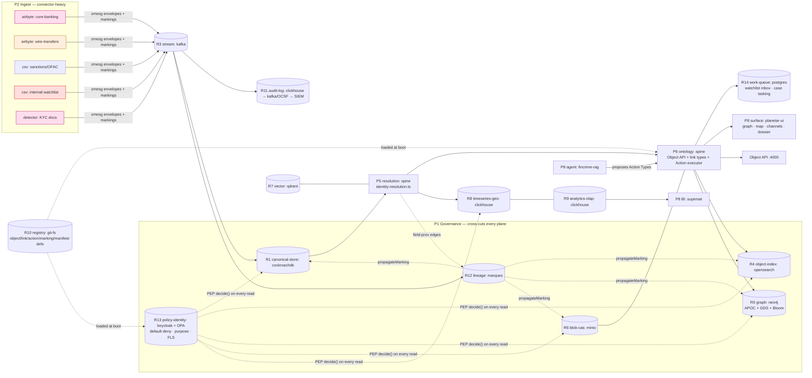

# 30-CLIENTS · Intel / Financial-Crime Graph

> One of the four reference clients ([`README §The four reference clients`](../README.md)). Each is a different *topology* over the same spine; this one is the **graph-first, governance-first** archetype.

## 1. Who this client is — the headline architecture story

This is the **Gotham-class investigative** deployment: a financial-intelligence unit (FIU), a sanctions/AML team, or a national-security analysis cell whose daily work is *entity/link analysis over a moving body of evidence* — accounts, persons, organizations, transactions, devices, locations — pulled from many feeds, resolved into one canonical entity per real-world thing, and traversed as a typed graph to find **rings, shells, brokers, and structuring patterns**, then worked as **cases** and packaged as **dossiers**. The architecture story is that this client takes the **built spine unchanged** — `planetar-broker` (R3) → identity resolution (P5) → `planetar-ontology` link types + Object API + kinetic Action executor (P6/P7) → `planetar-ui` (P8) — and binds the two roles that are *accessories* for the maritime client as its **primary** roles: a dedicated graph engine (**R5 → Neo4j**, for APOC + Graph Data Science + Bloom) and the full governance stack (**R10–R13**, with **marking propagation** as the differentiator — a `NOFORN`/compartment marking applied once at ingest gates every derived store, object, dossier, and export, automatically and audited). Everything Gotham charges for that is the *moat* — entity resolution, the typed link model, the audited single-write-path — is already built; what this manifest adds is **a graph engine bound behind the existing `GraphStore` port, a queryable+streamed audit pipeline, an OpenLineage lineage store, and a Keycloak+OPA PDP** — all OSS, all behind ports the spine already imports. The signature query is the **financial-crime ring detection Cypher** ([`§6.2`](#62-financial-crime-ring-detection-the-signature-query)); the signature governance act is **a watchlist hit raised as a kinetic Action Type** ([`§6.1`](#61-watchlist-alert-as-an-action-type)) whose marking is inherited, not re-declared.

What makes this **not a plain graph database**: a graph DB stores nodes and edges and answers traversals. This client stores nodes and edges *and* enforces that the answer to every traversal is filtered to what the analyst is cleared to see, with the clearance label **carried on the node by lineage propagation** rather than re-declared per query — so a denied object never appears in a ring, a path, a facet count, or a dossier. That is the `§7` markings story, and it is the clone-resistant core.

---

## 2. Enabled capabilities → union of role footprints

The capability keys (from [`20-PARITY-MATRIX/`](../20-PARITY-MATRIX/), decomposed in [`11 §2-3`](../11-CAPABILITY-ROLE-MAP.md)) this client enables, and the roles each *requires* (**bold** in the source map). The manifest compiler unions these into the **required role set**.

| Capability key | Plane(s) | Required roles (footprint) | Source feature |
|---|---|---|---|
| `link-analysis` | P6, P8 | **R5**, **R1** *(+R4)* | Gotham Graph/Vertex — neighbors, shortest path, ring/shell patterns |
| `identity-resolution` | P5 | **R1**, **R4**, **R12** *(+R7)* | fold many observations of one account/person into one golden entity |
| `kinetic-writes` | P7 | **R10**, **R1**, **R11**, **R3** *(+R13)* | the only write path: validated, audited, reversible Action Types |
| `geotemporal` | P8 | **R8**, **R1** *(+R5)* | Geotime/Gaia — pattern-of-life, rendezvous, geofence over time |
| `watchlists-alerting` | P7, P6 | **R10**, **R3**, **R14**, **R1** | saved object set + standing alert that fires an Action on new matches |
| `case-management` | P6, P8 | **R1**, **R10**, **R14** *(+R5)* | persistent investigation container: entities, notes, findings |
| `dossiers` | P8, P6 | **R1**, **R5** *(+R6, +R9)* | auto-assembled report on an entity from links + observations + media |
| `propagating-security` | P1 | **R12**, **R13**, **R11** | a marking applied at ingest flows along lineage to every derived artifact |
| `search-360` | P6, P8 | **R4**, **R1** *(+R7)* | full-text + structured search across every object type in one box |
| `agents-rag` | P7, P8 | **R7**, **R6**, **R10** *(+R5)* | grounded RAG agent that acts only through guardrailed Action Types |
| `audit` | P1 | **R11** | immutable, queryable, SIEM-exportable record of every read/write/export/AI action |
| `multi-tenancy` | P0 | **R10**, **R13** *(+R1)* | isolated compartments/tenants via per-manifest topology |

**Union of required roles** (the engine set the manifest must bind):

```
link-analysis       = {R5, R1}
identity-resolution = {R1, R4, R12}
kinetic-writes      = {R10, R1, R11, R3}
geotemporal         = {R8, R1}
watchlists-alerting = {R10, R3, R14, R1}
case-management     = {R1, R10, R14}
dossiers            = {R1, R5}
propagating-security= {R12, R13, R11}
search-360          = {R4, R1}
agents-rag          = {R7, R6, R10}
audit               = {R11}
multi-tenancy       = {R10, R13}
─────────────────────────────────────
REQUIRED = {R1, R3, R4, R5, R6, R7, R8, R10, R11, R12, R13, R14}
                                              (R2 hot-cache pulled in as an *enhancing* role
                                               for presence + PDP-decision cache; R9 analytics
                                               pulled in as *enhancing* for dossier statistics)
```

Twelve required roles + two enhancing (R2, R9) = **fourteen roles bound** — this is the *most-fully-provisioned* of the four reference clients, the opposite of the two-process maritime edge box. Every role earns its place from a capability above; nothing is bound by habit ([`13 §2`](../13-CLIENT-MANIFEST.md): *"you can't over-provision by habit"*).

---

## 3. The manifest

### 3.1 `manifest.yaml` — intel / financial-crime (scale / regulated)

Valid against [`13-CLIENT-MANIFEST.md`](../13-CLIENT-MANIFEST.md) (`planetar:ClientManifest`, schema_version 1.0). Engine choices follow the sibling adapter files: **Neo4j** for R5 ([`graph.md §8`](../40-ADAPTERS/graph.md) — the graph-first client), **clickhouse + kafka** audit and **marquez** lineage and **keycloak+OPA** policy for governance ([`governance.md §7`](../40-ADAPTERS/governance.md) — scale/regulated row), **cockroachdb** for R1 (regulated multi-region strong consistency, [`global-scale.md`](../40-ADAPTERS/global-scale.md)), **opensearch** for R4, **qdrant** for R7, **clickhouse** for R8/R9.

```yaml
# manifest.yaml — intel / financial-crime graph
schema_version: "1.0"

client:
  id: intel-fincrime
  name: "Intel / Financial-Crime Graph"
  tier: scale                          # scale | regulated defaults: strong R1, durable everything, PDP default-deny

# 1) WHAT — capability keys (20-PARITY-MATRIX/). Compiler unions footprints → required roles (§2).
capabilities:
  - link-analysis
  - identity-resolution
  - kinetic-writes
  - geotemporal
  - watchlists-alerting
  - case-management
  - dossiers
  - propagating-security          # THE differentiator vs a plain graph DB
  - search-360
  - agents-rag
  - audit
  - multi-tenancy
  # NOT enabled: dark-vessel-reid, media-sets(FMV), crm-pipeline → those extra roles never bind

# 2) HOW — bind every required role (§2) to an engine + config.
roles:
  canonical-store:                # R1 — regulated, multi-region, strongly consistent
    engine: cockroachdb           # pg-wire; or 'postgres' single-region, 'spanner' on GCP
    config:
      connection: { host: crdb.fiu.internal, port: 26257, db: canonical, pool: 30, ssl: require }
      hashShardKey: true          # avoid UUIDv7 right-edge hotspot (global-scale.md §2)
  hot-cache:                      # R2 — enhancing: PDP decision cache + analyst presence
    engine: redis
    config: { url: redis://redis.fiu.internal:6379, ttlSec: 30 }
  stream:                         # R3 — Kafka ecosystem: infinite retention, consumer groups, SIEM bridge
    engine: kafka
    config:
      brokers: [kafka1.fiu.internal:9092, kafka2.fiu.internal:9092, kafka3.fiu.internal:9092]
      envelope: zmesg             # the wire contract is still zmesg, even on kafka (10 §R3 note)
      topics: { prefix: fincrime, retention: infinite }
  object-index:                   # R4 — Search 360 + resolver blocking
    engine: opensearch
    config:
      nodes: [os1.fiu.internal:9200, os2.fiu.internal:9200]
      index: fincrime-objects
      docLevelSecurity: true      # PEP filters markings INSIDE the query (object-index.md §PEP)
  graph:                          # R5 — THE primary role: ring/shell/broker detection
    engine: neo4j                 # APOC + Graph Data Science (PageRank/community/betweenness) + Bloom
    config:
      url: bolt://neo4j.fiu.internal:7687
      user: planetar
      password: ${env:NEO4J_PASSWORD}
      database: fincrime
      plugins: [apoc, graph-data-science]
  blob-cas:                       # R6 — case attachments, statements, exported dossier packages
    engine: minio
    config: { endpoint: s3.fiu.internal:9000, bucket: fincrime-evidence, sse: true }
  vector:                         # R7 — RAG grounding + fuzzy-name / narrative similarity
    engine: qdrant
    config: { url: http://qdrant.fiu.internal:6333, collection: fincrime, dim: 1024 }
  timeseries-geo:                 # R8 — transaction time series + geotemporal pattern-of-life
    engine: clickhouse            # fire-hose transaction volume; also serves R9
    config: { url: http://ch.fiu.internal:8123, db: fincrime_ts }
  analytics-olap:                 # R9 — enhancing: dossier statistics, ring-value rollups, case metrics
    engine: clickhouse            # one clickhouse cluster covers R8 + R9 (timeseries-olap.md §collapse)
    config: { url: http://ch.fiu.internal:8123, db: fincrime_olap }
  registry:                       # R10 — SSOT for object/link/action/manifest/marking defs
    engine: git-fs
    config: { path: ./registry }
  audit-log:                      # R11 — queryable AND streamed to the agency SIEM
    engine: clickhouse            # query at scale (Event-Monitoring-class); + kafka sink below
    config:
      url: http://ch.fiu.internal:8123
      db: fincrime_audit
      siemSink: { engine: kafka, topic: fincrime.audit.siem, format: ocsf }
      hashChain: true             # tamper-evidence (governance.md §3.1)
  lineage:                        # R12 — the CARRIER for marking propagation
    engine: marquez               # OpenLineage; Monocle-class UI; field-level + marking facets
    config: { url: http://marquez.fiu.internal:5000, namespace: fincrime }
  policy-identity:                # R13 — Keycloak authn + OPA PDP (default-deny, purpose-based)
    engine: keycloak-opa
    config:
      realm: fincrime
      keycloakUrl: https://idp.fiu.internal
      opaUrl: http://opa.fiu.internal:8181/v1/data/planetar/authz/decision
      decisionCache: hot-cache    # cache decisions in R2 keyed (principal,action,resource,markings)
  work-queue:                     # R14 — watchlist-alert inbox, case tasking, agent-propose review
    engine: postgres              # FOR UPDATE SKIP LOCKED; or 'temporal' for long enrichment chains
    config: { connection: { host: pg.fiu.internal, db: workq } }

# 3) Ingest (P2) — connectors/detectors. Fincrime is connector-heavy (enterprise feeds), not sensor-heavy.
ingest:
  - { kind: connector, name: airbyte-postgres,  source: core-banking-db,   markingDefault: PII }
  - { kind: connector, name: airbyte-swift,      source: wire-transfers,    markingDefault: OPS-RESTRICTED }
  - { kind: connector, name: csv-import,         source: sanctions-ofac,    markingDefault: UNCLASS }
  - { kind: connector, name: csv-import,         source: watchlist-internal, markingDefault: NOFORN }
  - { kind: detector,  name: kyc-document-ingest, source: minio,            markingDefault: PII }

# 4) Surfaces (P8) — what analysts/agents touch.
surfaces:
  - { kind: shell,      name: planetar-ui, panes: [graph, map, channels, dossier] }
  - { kind: object-api, port: 4000 }
  - { kind: bi,         name: superset,    datasource: analytics-olap }   # dossier stats / case dashboards
  - { kind: agent,      name: fincrime-rag, grounding: [vector, graph], writesVia: kinetic }

# 5) Governance (P1) — the differentiator. Markings + propagation + queryable+streamed audit.
governance:
  markings:
    - { id: UNCLASS, default: true }
    - { id: PII }                                  # core-banking + KYC
    - { id: OPS-RESTRICTED }                       # active-investigation data
    - { id: NOFORN }                               # compartment; mandatory (need-to-know)
    - { id: SAR-FILING, mandatory: true }          # suspicious-activity-report material, conjunctive
  propagate: lineage                               # marking flows along R12 marquez edges (governance.md §4)
  purposeBasedAccess: true                         # OPA purpose_ok gate; NOFORN/SAR-FILING require a purpose
  fls: true                                        # obligations.redact masks fields per principal clearance
  audit: { sink: audit-log, export: { format: ocsf, to: siem }, readAudit: true }

# 6) Deploy (P0).
deploy:
  target: kubernetes
  notes: "regulated cloud; multi-region cockroachdb; air-gapped compartment option via tier=air-gapped (§3.2)"
```

### 3.2 Second manifest — air-gapped compartment (one diff, same capabilities, same code)

A sensitive compartment runs disconnected. **Capabilities and application code are byte-for-byte identical**; only the role *bindings* collapse onto fewer, offline engines ([`13 §3`](../13-CLIENT-MANIFEST.md): *"each client a different architecture = each client a different manifest; nothing else forks"*). This proves the same investigative platform runs on a regulated multi-region cloud and on an air-gapped box.

```diff
 client:
   id: intel-fincrime
-  tier: scale
+  tier: air-gapped
 roles:
   canonical-store:
-    engine: cockroachdb
-    config: { connection: { host: crdb.fiu.internal, ... } }
+    engine: sqlite
+    config: { path: ./data/canonical.db }
   stream:
-    engine: kafka
-    config: { brokers: [kafka1.fiu.internal:9092, ...] }
+    engine: broker                    # the native ns bus; same zmesg envelope
+    config: { pub: 12001, sub: 12002, wal: ./wal }
   object-index:
-    engine: opensearch
+    engine: sqlite                    # FTS5 in the same canonical.db — no search service
+    config: { path: ./data/canonical.db, fts: true }
   graph:
-    engine: neo4j
+    engine: falkordb                  # Redis-module graph on the box you have; same Cypher, same port
+    config: { url: redis://127.0.0.1:6379, graph: fincrime }
   vector:
-    engine: qdrant
+    engine: pgvector                  # rides a small local pg (or unbound if agents-rag dropped offline)
+    config: { connection: { host: 127.0.0.1, db: vec }, dim: 1024 }
   timeseries-geo:
-    engine: clickhouse
+    engine: postgis                   # local pg + postgis; same TimeSeriesGeo port
   analytics-olap:
-    engine: clickhouse
+    engine: duckdb                    # embedded columnar; no cluster
+    config: { path: ./data/olap.duckdb }
   audit-log:
-    engine: clickhouse
+    engine: append-wal                # broker-style WAL, hash-chained, no SIEM (export: none)
+    config: { path: ./audit }
   lineage:
-    engine: marquez
+    engine: postgres                  # recursive-CTE lineage on the same local pg; SAME propagate rules
   policy-identity:
-    engine: keycloak-opa
+    engine: internal                  # local principals + embedded OPA-WASM bundle; same Rego, no network
+    config: { policyBundle: ./policy }
   work-queue:
-    engine: postgres
+    engine: sqlite
+    config: { path: ./data/work.db }
 governance:
-  audit: { sink: audit-log, export: { format: ocsf, to: siem }, readAudit: true }
+  audit: { sink: audit-log, export: none, readAudit: true }   # markings STILL propagate (engine is spine code)
 deploy:
-  target: kubernetes
+  target: pm2
+  host: airgap-box
+  notes: "fully offline; zero external services; markings propagate via spine, audit hash-chained on WAL"
```

The propagating-security guarantee holds on **both** manifests because the propagation engine is spine code that depends only on the R12/R13/R11 *ports* ([`governance.md §4.2`](../40-ADAPTERS/governance.md)) — marquez+keycloak+opa+clickhouse on the cloud, postgres-CTE+internal+append-wal on the air-gapped box, *same Rego bundle, same envelope, same closure walk*.

---

## 4. Topology (from the scale manifest)



The governance subgraph is the whole point: **markings flow `ingest → lineage → propagateMarking → every derived store`, and every store's adapter is a PEP that calls `PDP.decide()` before returning a row.** A plain graph DB has the `GR` node and the traversals; it does not have the `Gov` subgraph wrapping every store.

---

## 5. Capability coverage (feature → roles → engine → status → reuse vs net-new)

| Feature | Required roles | Bound engine(s) | Status | Reused from repos / net-new |
|---|---|---|---|---|
| Typed object/link model (Account, Person, Org, Transaction, owns/transfers_to) | R1, R10 | cockroachdb · git-fs | **built** | `planetar-ontology` object/link types; doibio 35-schema breadth proves the pattern — *reused* |
| Identity resolution / dedup (one golden Account per real account) | R1, R4, R12 | cockroachdb · opensearch · marquez | **built** (resolver) / partial (marquez wiring) | `planetar-ontology/src/resolve/resolve.ts` + `doibio/src/lib/identity-resolution.ts` (631 LOC) — *reused*; opensearch blocking + marquez emit *net-new wiring* |
| Per-field provenance / golden master | R1, R12 | cockroachdb · marquez | **built** (provenance) | ontology per-field `_provenance` (`src/store/schema.sql`) — *reused*; OpenLineage emit *net-new* |
| Graph / link explorer ("search around") | R5, R1 | **neo4j** | **partial → designed** | `GraphStore` port + `runGraphProjector` ([`graph.md §3`](../40-ADAPTERS/graph.md)) *reused*; Neo4j adapter binding *net-new* (links are built in R1 today) |
| Shortest path ("how are these two connected") | R5, R1 | neo4j | **designed** | `Neo4jCanonicalGraph.shortestPath` ([`graph.md §4.2`](../40-ADAPTERS/graph.md)) — adapter *net-new*, Cypher written |
| **Ring / cycle detection** (laundering loops, structuring) | R5, R1, *R9* | neo4j · clickhouse | **designed** | ring Cypher in [`graph.md §5.3`](../40-ADAPTERS/graph.md) *reused verbatim*; exposed as ontology Function `detectTransferRing` ([`§6.2`](#62-financial-crime-ring-detection-the-signature-query)) — *net-new Function registration* |
| Network ranking (PageRank, community, betweenness-of-broker) | R5 | neo4j + GDS | **designed** | Neo4j Graph Data Science library (OSS) behind R5 — *net-new*, engine-native |
| Search 360 / global search | R4, R1 | opensearch | **partial** | `ObjectIndex` port + doibio Elasticsearch (`src/lib/elasticsearch.ts`) — *reused*; opensearch binding *net-new* |
| Semantic / narrative similarity (RAG grounding, fuzzy names) | R7, R1 | qdrant | **designed** | `VectorStore` port — *reused shape*; qdrant adapter + embedding pipeline *net-new* |
| Geotemporal pattern-of-life / rendezvous / geofence | R8, R1 | clickhouse | **partial → designed** | track model + `kinematics.ts` *reused*; clickhouse R8 binding *net-new* |
| Watchlist saved-set + standing alert | R10, R3, R14, R1 | git-fs · kafka · postgres | **designed** | object sets built (`planetar-ontology` Object API); standing-alert Action trigger ([`§6.1`](#61-watchlist-alert-as-an-action-type)) *net-new* |
| Case management (container of entities/notes/findings) | R1, R10, R14 | cockroachdb · git-fs · postgres | **designed** | Case modeled as an ontology object type + Action Types — *net-new types*, executor *reused* |
| Dossier (auto-assembled entity report) | R1, R5, *R6/R9* | cockroachdb · neo4j · minio · clickhouse | **partial** | doibio report routes (canned-SQL) *reused as donor*; `neighbors()` expansion render *net-new*; declarative report builder is a known gap |
| Kinetic writes (the only write path) | R10, R1, R11, R3 | git-fs · cockroachdb · clickhouse · kafka | **built** | `planetar-ontology/src/actions/executor.ts` precondition→effect→audit — *reused unchanged* |
| **Markings + propagating security** | R12, R13, R11 | marquez · keycloak+OPA · clickhouse | **designed** (the keystone gap) | propagation engine `spine/governance/propagation.ts` + Rego bundle ([`governance.md §4`](../40-ADAPTERS/governance.md)) — *net-new spine*; ontology gate + provenance *reused* |
| Comprehensive audit (read+write, queryable, SIEM) | R11 | clickhouse + kafka(OCSF) | **partial** | write/action audit built (`executor.ts` `core:Event`; doibio `event-log.ts`) — *reused*; **read** audit + clickhouse/kafka sink + OCSF codec *net-new* |
| FLS / row-level (mask fields per clearance) | R13, R1 | keycloak+OPA | **designed** (gap) | `obligations.redact` PEP shape ([`governance.md §4.3`](../40-ADAPTERS/governance.md)) — *net-new*; doibio has **no FLS** (cannot borrow) |
| Agent / RAG (acts only via Action Types) | R7, R6, R10 *(+R5)* | qdrant · minio · git-fs · neo4j | **designed** | kinetic containment ([`palantir-aip-apollo.md`](../20-PARITY-MATRIX/palantir-aip-apollo.md)) *reused*; LLM gateway + agent loop *net-new* (doibio Cohere chat is the closest donor) |
| Live / collaborative case updates | R3, R2, R1 | kafka · redis | **built/partial** | Object API WS (`planetar-ontology/src/api/ws.ts`) *reused*; redis presence *net-new* |
| Multi-tenant compartments | R10, R13 | git-fs · keycloak+OPA | **partial** | per-client manifest model ([`13`](../13-CLIENT-MANIFEST.md)) *reused*; multi-tenancy hardening is an explicit GAP |

**Status tally:** built 5 · built/partial 1 · partial 5 · partial→designed 2 · designed 8. The pattern matches the Gotham parity summary ([`palantir-gotham.md §Coverage`](../20-PARITY-MATRIX/palantir-gotham.md)): the **core investigative loop is built spine**; the deltas are a graph engine bound behind an existing port, the governance/propagation story, and analyst-surface polish.

---

## 6. Client-specific sample code (real port interfaces)

### 6.1 Watchlist alert as an Action Type

A watchlist is a saved object set; a hit is detected by a stream consumer; the hit is raised **as a kinetic Action Type** so it is validated, audited, attributed, reversible, and **marking-aware** — never a raw write. This is the `watchlists-alerting` capability, and it shows the spine's Action executor (`planetar-ontology/src/actions/executor.ts`, reused unchanged) plus the `Stream`, `WorkQueue`, and `PolicyIdentity` ports.

```ts
// 30-CLIENTS/intel-fincrime/watchlist-alert.action.ts
import type { BoundPlatform } from '../../spine/control/binder';
import type { Stream } from '../../spine/ports/stream';
import type { WorkQueue } from '../../spine/ports/work-queue';
import type { ActionType, ActionCtx } from '../../spine/ontology/actions';   // executor’s registration shape

// 1) The Action Type — registered in R10, executed by the built kinetic executor.
//    precondition (reads via ontology) → effect (one canonical mutation) → audit envelope.
export const RaiseWatchlistAlert: ActionType<{ entityId: string; watchlistId: string; matchedTerm: string }> = {
  id: 'fincrime:RaiseWatchlistAlert',
  version: '1.0.0',
  parameters: { entityId: 'EntityId', watchlistId: 'EntityId', matchedTerm: 'string' },

  // PRECONDITION — read-only check via the Object API; no duplicate open alert for this (entity, watchlist).
  async precondition({ entityId, watchlistId }, ctx: ActionCtx) {
    const existing = await ctx.objects.list('fincrime:Alert', {
      filter: [
        { field: 'entityId', op: '=', value: entityId },
        { field: 'watchlistId', op: '=', value: watchlistId },
        { field: 'status', op: '=', value: 'open' },
      ],
      limit: 1,
    });
    return existing.items.length === 0
      ? { ok: true }
      : { ok: false, reason: 'alert-already-open' };       // idempotent: standing alert won’t double-fire
  },

  // EFFECT — the ONLY mutation: create one Alert entity + an `alerted_on` link to the entity.
  //   The executor wraps this in R1.transaction, then emits the audit core:Event on R3.
  //   The Alert INHERITS the target entity’s markings via propagation — never re-declared here.
  async effect({ entityId, watchlistId, matchedTerm }, ctx: ActionCtx) {
    const target = await ctx.objects.get('fincrime:Account', entityId);
    const alertId = ctx.newId();                            // UUIDv7
    return {
      upserts: [{
        type: 'fincrime:Alert', id: alertId,
        body: { entityId, watchlistId, matchedTerm, status: 'open', raisedBy: ctx.principal.id },
        // marking inheritance: union of the watchlist’s markings and the hit entity’s markings
        markings: [...new Set([...(target?.markings ?? []), ...ctx.markingsOf(watchlistId)])],
      }],
      links: [{ type: 'alerted_on', from: alertId, to: entityId, body: { ts: ctx.nowNs() } }],
      // route to the analyst inbox (R14) — claimed, worked, completed
      enqueue: { queue: 'fincrime:alert-triage', payload: { alertId, entityId } },
    };
  },
};

// 2) The standing-alert consumer: tails R3, evaluates each new canonical entity against active
//    watchlists, and invokes the Action Type above on a match. Pure ports — engine-agnostic.
export async function runWatchlistEngine(platform: BoundPlatform) {
  const stream = platform.role<Stream>('stream');           // kafka here; broker at the edge
  const queue = platform.role<WorkQueue>('work-queue');     // postgres SKIP LOCKED
  const watchlists = await loadActiveWatchlists(platform);  // saved object sets (R10 + R4)

  for await (const env of stream.subscribe(['canonical.entity.fincrime:Account.*'], 'latest')) {
    const acct = env.payload as { id: string; body: Record<string, unknown> };
    for (const wl of watchlists) {
      const term = wl.match(acct);                           // name/alias/identifier/risk-threshold predicate
      if (!term) continue;
      // invoke through the kinetic executor → validated, governed (PDP), audited, reversible:
      await platform.kinetic.invoke(RaiseWatchlistAlert, {
        entityId: acct.id, watchlistId: wl.id, matchedTerm: term,
      }, { principal: SYSTEM_PRINCIPAL, purpose: 'watchlist-screening' });
    }
    await stream.ack(env.offset);
  }
  void queue;                                                // triage inbox drained by analyst surface
}
```

The payoff: the alert is created by the same precondition→effect→audit path a human edit uses, so it is in the tamper-evident audit log, attributable to `SYSTEM_PRINCIPAL` with `purpose: 'watchlist-screening'`, reversible by replaying its inverse, and — critically — **carries the inherited markings** so an analyst not cleared for `NOFORN` never sees the alert.

### 6.2 Financial-crime ring detection (the signature query)

The flagship traversal, exposed as a typed ontology **Function** `detectTransferRing` over the `GraphStore` port — bound to **Neo4j** here (with GDS available for ranking). The Cypher is reused verbatim from [`graph.md §5.3`](../40-ADAPTERS/graph.md); this shows it wrapped as a port-level domain query the surface and the RAG agent both call.

```ts
// 30-CLIENTS/intel-fincrime/ring-detection.ts
import type { GraphStore } from '../../spine/ports/graph-store';
import type { PolicyIdentity, Principal } from '../../spine/ports/policy-identity';

export interface Ring { ringNodeIds: string[]; ringEdgeIds: string[]; ringLength: number; totalAmount: number; }

/**
 * detectTransferRing — closed loop of `transfers_to` of length 2..maxLen starting+ending at `seed`,
 * whose summed amount exceeds `minTotal` (a laundering cycle). Runs on whichever R5 engine the
 * manifest bound (neo4j here); the Cypher body is identical on falkordb/memgraph/age.
 */
export async function detectTransferRing(
  graph: GraphStore,
  args: { seed: string; maxLen?: number; minTotal?: number },
  ctx: { principal: Principal; pdp: PolicyIdentity },
): Promise<Ring[]> {
  // PEP: the principal must be cleared to run network analysis on this seed before we traverse.
  const d = await ctx.pdp.decide({
    principal: ctx.principal, action: 'graph-analyze',
    resourceType: 'fincrime:Account', resourceId: args.seed, markings: [], purpose: 'investigation',
  });
  if (!d.allow) throw new Error(`denied: ${d.reason}`);

  // The signature ring-detection Cypher (graph.md §5.3) — shipped through the GraphStore engine.
  const cypher = `
    MATCH p = (a:Entity {id: $seed})-[r:LINK*2..${args.maxLen ?? 6}]->(a)
    WHERE all(e IN relationships(p) WHERE e.props.type = 'transfers_to')
      AND reduce(amt = 0.0, e IN relationships(p) | amt + coalesce(e.props.amount, 0.0)) > $minTotal
    RETURN [n IN nodes(p) | n.id]         AS ringNodeIds,
           [e IN relationships(p) | e.id] AS ringEdgeIds,
           length(p)                      AS ringLength,
           reduce(amt = 0.0, e IN relationships(p) | amt + coalesce(e.props.amount, 0.0)) AS totalAmount
    ORDER BY totalAmount DESC
    LIMIT 50`;

  // raw() is the adapter’s escape hatch for a registered Function’s engine-native query;
  // results are still markings-filtered by the graph adapter’s PEP (denied nodes never appear in a ring).
  const rows = await graph.raw<Ring>(cypher, { seed: args.seed, minTotal: args.minTotal ?? 0 });
  return rows;
}

// Registered as an ontology Function (R10) so the Object API, the dossier surface, and the
// fincrime-rag agent all call it identically — the agent can ONLY read through it, never write.
export const DetectTransferRingFn = {
  id: 'fincrime:detectTransferRing', version: '1.0.0',
  params: { seed: 'EntityId', maxLen: 'int?', minTotal: 'float?' },
  returns: 'Ring[]', run: detectTransferRing,
} as const;
```

### 6.3 Marking-propagating PEP read (why this is not a plain graph DB)

The differentiator made executable: the graph adapter's `neighbors` read is wrapped by the **same three-line PEP** every adapter uses ([`governance.md §4.3`](../40-ADAPTERS/governance.md)), so a denied node is absent from the link chart — not hidden in the UI, but never returned by the store. The marking is *on the node* because propagation put it there.

```ts
// 30-CLIENTS/intel-fincrime/graph-pep.ts — the markings-aware "search around" the dossier renders
import type { GraphStore, Subgraph, TraversalSpec, EntityId } from '../../spine/ports/graph-store';
import type { PolicyIdentity, Principal } from '../../spine/ports/policy-identity';
import type { AuditLog } from '../../spine/ports/audit-log';

export async function neighborsCleared(
  graph: GraphStore, pdp: PolicyIdentity, audit: AuditLog,
  rootId: EntityId, spec: TraversalSpec,
  ctx: { principal: Principal; purpose?: string },
): Promise<Subgraph> {
  const sub = await graph.neighbors(rootId, spec);          // engine traversal (neo4j) returns nodes+edges
  const visible = [];
  for (const n of sub.nodes) {
    const markings = (n.props.markings as string[] | undefined) ?? [];   // propagated by R12, carried on the node
    const d = await pdp.decide({                            // DEFAULT DENY unless clearances ⊇ markings
      principal: ctx.principal, action: 'read',
      resourceType: n.type, resourceId: n.id, markings, purpose: ctx.purpose,
    });
    await audit.append({                                    // every read audited, tamper-evident
      id: '', ts: Date.now() * 1e6, principal: ctx.principal.id, action: 'read',
      resourceType: n.type, resourceId: n.id, markings, outcome: d.allow ? 'allow' : 'deny',
    });
    if (d.allow) visible.push(d.obligations?.redact ? redactProps(n, d.obligations.redact) : n);
  }
  const visibleIds = new Set(visible.map((n) => n.id));
  return {                                                  // edges to denied nodes drop with their endpoints
    root: rootId, nodes: visible,
    edges: sub.edges.filter((e) => visibleIds.has(e.from) && visibleIds.has(e.to)),
  };
}

function redactProps(n: any, fields: string[]) {            // FLS: mask fields the principal can't see
  const props = { ...n.props };
  for (const f of fields) if (f in props) props[f] = '███';
  return { ...n, props };
}
```

A plain graph DB returns the whole neighborhood. This returns the neighborhood **the analyst is cleared for**, with the clearance label carried by lineage propagation and the decision audited — the exact line that separates this client from `neo4j` alone.

---

## 7. Reuse vs build

**Reused from `planetar-*` / `doibio` unchanged (the moat — do not rebuild):**

- **Spine bus + envelope** — `planetar-broker` (R3) + `zmesg`; here bound to **kafka** at scale, **broker** air-gapped, but the spine and detectors emit the same envelope on both ([`10 §R3 note`](../10-STORAGE-ROLES.md)).
- **Identity resolution + per-field provenance** — `planetar-ontology/src/resolve/resolve.ts` + `doibio/src/lib/identity-resolution.ts` (631 LOC). The financial-crime "one golden Account per real account, with conflict adjudication" is the *same engine* as dark-vessel re-ID, different `type` vocabulary.
- **Kinetic Action executor (the only write path)** — `planetar-ontology/src/actions/executor.ts`, precondition→effect→audit→reproject. The watchlist Action ([`§6.1`](#61-watchlist-alert-as-an-action-type)) runs through it unchanged.
- **Typed object/link model + Object API + WS** — `planetar-ontology` (`src/api/server.ts`, `ws.ts`); doibio's 35-schema breadth proves the object model scales to a rich domain.
- **The `GraphStore` port + R3→R5 projector** — `runGraphProjector` ([`graph.md §3`](../40-ADAPTERS/graph.md)); links are *already built* in R1 (`link` table), so binding Neo4j is "run the projector from offset 0, cut over reads" — no migration.
- **The governance ports + propagation engine + Rego bundle** — `spine/governance/propagation.ts`, the PEP shape, the default-deny `authz.rego` ([`governance.md §4`](../40-ADAPTERS/governance.md)). The ontology gate and per-field provenance are the built substrate under them.
- **Search blocking** — `planetar-ontology/src/store/store.ts` `findEntityIdsByIdentifier` generalizes to `ObjectIndex.searchCandidates` on opensearch ([`object-index.md`](../40-ADAPTERS/object-index.md)); doibio's Elasticsearch (`src/lib/elasticsearch.ts`) is the working donor.
- **Audit substrate** — doibio's append-only `event-log.ts` + the broker WAL+CRC32; here the **scan/export/hash-chain/SIEM-codec** layer is added on top.

**Net-new for this client (OSS bindings + thin spine adds, behind existing ports):**

- **Neo4j R5 adapter** bound and indexed; **APOC + Graph Data Science** for PageRank/community/betweenness ranking of a link chart; **Bloom** for analyst exploration — all engine-native OSS, behind the `GraphStore` port the spine already imports.
- **`detectTransferRing` / shared-beneficiary structuring** registered as ontology **Functions** ([`§6.2`](#62-financial-crime-ring-detection-the-signature-query)); the Cypher exists ([`graph.md §5.3`](../40-ADAPTERS/graph.md)), the *Function registration + surface wiring* is new.
- **Watchlist standing-alert engine** ([`§6.1`](#61-watchlist-alert-as-an-action-type)) — the R3 consumer + the `RaiseWatchlistAlert` Action Type + the R14 triage inbox.
- **Case + Alert + Watchlist + Dossier object types** registered in R10 (Case management/dossiers are *new types*, the executor and Object API are reused).
- **Governance pipeline wiring** — marquez OpenLineage emit on every transform, clickhouse+kafka(OCSF) audit sink, keycloak realm + OPA bundle deployment, decision cache in redis. The *rules* are spine; the *engine bindings* are new.
- **qdrant R7 + embedding pipeline** for RAG grounding and fuzzy-name similarity; **fincrime-rag agent** loop + LLM gateway (kinetic-contained writes).
- **Airbyte/CSV connectors** for core-banking, SWIFT, OFAC, internal watchlist — the enterprise-feed long tail this client lives on (vs. the maritime client's native sensor detectors).

**Gaps that must close before this client is production-real** (all named in the parity matrix as designed/GAP, ordered by blocking-weight):

1. **Marking propagation across stores (the keystone).** The marking *model*, the lineage substrate, and per-field provenance are built/designed, but the propagation rules that auto-stamp every derived store/object/dossier/export from one upstream marking are **designed-only** (`planetar-ontology/src/store/schema.sql` has a `provenance` column but **no marking column**). This is the single highest-value, highest-risk gap — the entire `§7` differentiator depends on it. ([`governance.md §4`](../40-ADAPTERS/governance.md), [`palantir-foundry-governance.md`](../20-PARITY-MATRIX/palantir-foundry-governance.md).)
2. **No FLS / row-level sharing.** `obligations.redact` and per-record grants are designed; doibio has **neither** (confirmed `src/lib/auth.ts`, single coarse `role` string) so nothing can be borrowed. Compartmented intel work *requires* both.
3. **PEP enforcement not wired.** Every adapter is a *declared* PEP (`12 §1` `MarkingResolver`) but **no adapter currently consults it** — restricted views, mandatory `NOFORN`/`SAR-FILING` markings, and purpose-based access all block on this.
4. **Read auditing missing.** Write/action audit is structural; Foundry-grade audit (and `§6.3`) also logs every *read/query/export* — designed-only.
5. **Dedicated graph engine unbound today.** Traversal runs over the canonical store; shortest-path and ring/shell pattern matching need the real Neo4j binding behind the existing port (data is built, engine is not).
6. **Declarative report builder.** Dossiers lean on doibio's canned-SQL reports; a Foundry-Contour / SF-report-builder equivalent is a known gap (`R9` analytics catalogued, no builder).
7. **Agent studio / LLM gateway.** Kinetic containment is the designed guardrail; the agent loop, tool-schema export, and RAG embedding pipeline are net-new (AIP studio is an inventory GAP; doibio Cohere chat is the closest donor).
8. **Multi-tenancy hardening.** Per-manifest topology gives logical compartment isolation; deployment-level tenant isolation is an explicit GAP.

The shape of the reuse is the thesis: **the investigative core loop is built spine, reused byte-for-byte; what this client adds is engine bindings behind ports that already exist and the propagating-security pipeline — and that pipeline is the one piece that makes it Gotham rather than Neo4j.**
