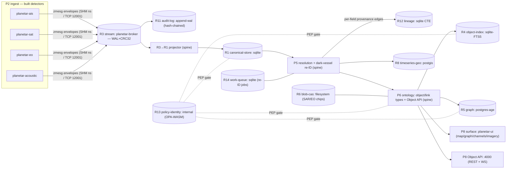
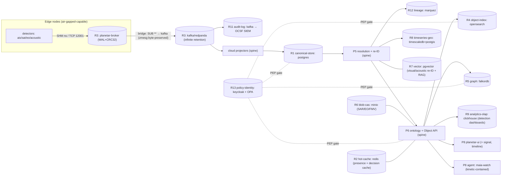

# 30 — Reference Client · Maritime / Defence (`planetar`)

This is the **built** reference client — the one the whole platform was extracted from. Everything other clients ([biotech CRM](./biotech-crm.md), [generic enterprise](./generic-enterprise.md), [intel / financial-crime](./intel-financial-crime.md)) does by *re-binding* the same spine to different engines, the maritime client does *natively*, because the spine repos (`zmesg`, `planetar-broker`, `planetar-ontology`, the four detectors, `planetar-ui`) **are** the maritime build. Read it first to see the role→engine model running on real code, then see the others prove the same capabilities on a different engine mix.

> Status legend ([`README`](../README.md)): ✅ built · 🟡 partial/designed · 🔲 planned. Capability keys and role footprints are from [`11`](../11-CAPABILITY-ROLE-MAP.md); engine choices match [`40-ADAPTERS/`](../40-ADAPTERS/); the manifest validates against [`13`](../13-CLIENT-MANIFEST.md).

---

## 1. Who the client is, and the headline architecture story

The maritime / defence client is a **dark-vessel detection and re-identification** system: it ingests live AIS, SAR, EO (camera), hydrophone-acoustic, and RF feeds, fuses them on a nanosecond message bus, resolves the heterogeneous observations into one canonical **Vessel** entity per real-world hull, and — when a vessel goes AIS-dark and reappears as an identifier-less SAR/EO/acoustic detection — **re-acquires** it by dead-reckoning every known track forward and scoring kinematic proximity (`planetar-ontology/src/resolve/kinematics.ts`, built). Analysts work it through a Slack-style 4-pane shell (`planetar-ui`): a maplibre map of live tracks, a link-chart of fused entities, per-MMSI conversation channels, and an imagery lane for SAR/EO chips. The headline architecture story is **the same byte-for-byte spine running two ways**: at the **edge / air-gapped** tier it is *two processes and zero external services* — one `sqlite` file (R1+R4+R10+R14), the `planetar-broker` ns bus (R3+R11), the filesystem (R6), one small `postgis` for geo/graph (R8+R5), `pgvector` riding it (R7), and an embedded OPA bundle (R13) — an offline-capable box that fits on a ship or a forward node; at the **scale / regional** tier the *identical ontology, resolver, Object API, detectors, and UI* re-bind to `postgres`+`opensearch`+`broker→kafka`+`minio`+`clickhouse`+`falkordb`+`keycloak/OPA`, and **no application code changes** — the manifest is the only diff. That Apollo-style "same artifact, air-gapped delivery, edge orchestration" property is the maritime differentiator, and it is exactly what the role/port architecture buys.

---

## 2. Enabled capabilities → union of role footprints

Capability keys from [`11 §2/§3`](../11-CAPABILITY-ROLE-MAP.md). The manifest compiler unions their **required** role footprints to compute the client's required role set; *enhancing* roles (italic) improve a capability but their absence only degrades, not breaks it.

| Capability key | Plane(s) | Required roles | *Enhancing* | Source product |
|---|---|---|---|---|
| `streaming-ingestion` | P2,P3 | **R3** | — | Foundry streaming, Gotham connectors |
| `identity-resolution` | P5 | **R1**, **R4**, **R12** | *R7* | Foundry/Data Cloud/Gotham entity res |
| `kinetic-writes` | P7 | **R10**, **R1**, **R11**, **R3** | *R13* | Foundry Actions (the only write path) |
| `dark-vessel-reid` | P5 | **R1**, **R8** | *R7* | planetar flagship (kinematic re-ID) |
| `geotemporal` | P8 | **R8**, **R1** | *R5* | Gotham Geotime / Gaia / SF Maps |
| `link-analysis` | P6,P8 | **R5**, **R1** | *R4* | Gotham Graph / Vertex |
| `media-sets` | P2,P6,P8 | **R6**, **R1** | *R7* | Foundry media sets, Gotham imagery/FMV |
| `audit` | P1 | **R11** | — | Foundry audit / SF Shield |
| `agents-rag` *(optional, scale only)* | P7,P8 | **R7**, **R6**, **R10** | *R5* | AIP / Agentforce (kinetic-contained) |

**Union of required roles (core, both tiers):** `{ R1, R3, R4, R5, R6, R8, R10, R11, R12, R13, R14 }`.
- R14 (work-queue) is pulled in by `kinetic-writes`' alert/trigger path and re-ID job fan-out; R13 enters as the *enhancing* gate on `kinetic-writes` but is bound at both tiers because every adapter is a PEP ([`governance.md §1`](../40-ADAPTERS/governance.md)).
- **Never bound at the maritime edge:** **R2** hot-cache (no durable-cache need; compiler falls back to in-process LRU), **R9** analytics-olap (no offline big-scan reporting), **R7** vector (kinematic re-ID is enough; visual re-ID is the *enhancing* add). The scale tier adds **R9** (clickhouse) and **R7** (pgvector/qdrant) when the regional command tier wants detection dashboards and visual/acoustic re-ID + RAG agents — turning on `agents-rag` is what *forces* R7 to bind, by compile rule ([`13 §2`](../13-CLIENT-MANIFEST.md)).

Why this footprint and not Salesforce's: the maritime client never enables `crm-pipeline` or `reporting-olap` at the edge, so it never binds R9 by habit — the over-provisioning the manifest compiler refuses ([`13 §2`](../13-CLIENT-MANIFEST.md)). The footprint is Gotham-shaped (ingest → resolve → graph → kinetic act → geotemporal surface), confirmed feature-by-feature in [`palantir-gotham.md`](../20-PARITY-MATRIX/palantir-gotham.md).

---

## 3. The two manifests

Same `client.id`, same `capabilities`, same spine code, same detectors, same UI. **Only `client.tier`, the `roles` bindings, and `deploy` change.** This *is* the product claim of [`13 §3`](../13-CLIENT-MANIFEST.md), made concrete for the built client.

### 3.1 Edge / air-gapped manifest (the built default — two processes, zero external services)

```yaml
# 30-CLIENTS/manifests/planetar-maritime.edge.yaml
schema_version: "1.0"

client:
  id: planetar-maritime
  name: "Maritime / Defence (planetar) — edge"
  tier: air-gapped                  # contract defaults: single-node, offline, no external services

# WHAT — capability keys; compiler unions footprints → required roles (§2).
capabilities:
  - streaming-ingestion
  - identity-resolution
  - kinetic-writes
  - dark-vessel-reid
  - geotemporal
  - link-analysis
  - media-sets
  - audit
  # NOT enabled at the edge: agents-rag, reporting-olap, crm-pipeline → R7/R9 never bind.

# HOW — bind each required role. The collapse: 11 roles onto 4 stores + the broker + an OPA bundle.
roles:
  canonical-store:                  # R1 — system-of-record projection
    engine: sqlite
    config: { path: ./data/canonical.db }          # planetar-ontology's store today
  stream:                           # R3 — the ns bus; envelope = zmesg; THIS IS THE SOURCE
    engine: broker
    config: { host: 127.0.0.1, pub: 12001, sub: 12002, udp: 12003, wal: ./wal }
  object-index:                     # R4 — sqlite FTS5, same .db file (no search service)
    engine: sqlite
    config: { path: ./data/canonical.db, fts: true }
  graph:                            # R5 — link analysis; one small pg, no second graph service
    engine: postgres-age
    config: { connection: { host: 127.0.0.1, db: graph }, graph: planetar }
  blob-cas:                         # R6 — SAR/EO chips as content-addressed files
    engine: filesystem
    config: { root: ./blobs }                       # store/<aa>/<bb>/<sha256> + sidecar
  timeseries-geo:                   # R8 — AIS/SAR/EO tracks + geo-within/near
    engine: postgis
    config: { connection: { host: 127.0.0.1, db: tracks } }   # plain postgis (no hypertable offline)
  registry:                         # R10 — schema/ontology/action/manifest SSOT
    engine: git-fs
    config: { path: ./registry }
  audit-log:                        # R11 — broker-WAL-style append-only, hash-chained
    engine: append-wal
    config: { path: ./audit }
  lineage:                          # R12 — per-field provenance + marking propagation closure
    engine: sqlite
    config: { path: ./data/canonical.db }           # recursive-CTE lineage in the same file
  policy-identity:                  # R13 — no Keycloak; local principals + embedded OPA-WASM bundle
    engine: internal
    config: { principals: ./policy/principals.json, policyBundle: ./policy/bundle.tar.gz }
  work-queue:                       # R14 — re-ID jobs + alert triggers
    engine: sqlite
    config: { path: ./data/work.db }
  # hot-cache (R2) omitted → compiler binds in-process LRU (no capability needs a durable cache).
  # vector (R7), analytics-olap (R9) unbound → no capability requires them at the edge.

# INGEST — the four built detectors (RF lane registered, no service yet).
ingest:
  - { kind: detector, name: planetar-ais,      areas: [victoria], topics: [vessel.ais.*] }
  - { kind: detector, name: planetar-sat,      mode: replay,  topics: [sar.detection, sar.chip] }
  - { kind: detector, name: planetar-eo,       sources: [victoria-webcams], topics: [eo.detection] }
  - { kind: detector, name: planetar-acoustic, source: synth, topics: [acoustic.detection] }
  # - { kind: detector, name: planetar-rf, status: registered-no-service }   # RF lane (README GAPS)

# SURFACES — the built 4-pane shell + the Object API (OSDK-equivalent).
surfaces:
  - { kind: shell, name: planetar-ui, panes: [map, graph, channels, imagery] }
  - { kind: object-api, port: 4000, transports: [rest, ws] }   # planetar-ontology/src/api

# GOVERNANCE — markings applied at the detector edge propagate along lineage to every fused entity.
governance:
  markings:
    - { id: UNCLASS, default: true }
    - { id: OPS-RESTRICTED }
  propagate: lineage                # markings flow along R12 closure (governance.md §4)
  audit: { sink: audit-log, export: none }           # offline; no SIEM egress

# DEPLOY — Apollo-style: a single signed bundle, runs fully offline.
deploy:
  target: apollo-style              # signed offline bundle; pm2 inside; no inbound network
  host: edge-node
  airgapped: true
  notes: "fully offline-capable; no external services; the whole platform is `sqlite + broker + pg + files`"
```

### 3.2 Scale / regional manifest (same capabilities, regional engines, `agents-rag` on)

The diff from §3.1 is **bindings + two added capabilities**, never code. The broker stays at the edge nodes and is *bridged* to Kafka for cloud retention — both are R3 bindings, one wire contract (`zmesg`), identity preserved across the hop ([`stream.md §7`](../40-ADAPTERS/stream.md)).

```yaml
# 30-CLIENTS/manifests/planetar-maritime.scale.yaml
schema_version: "1.0"

client:
  id: planetar-maritime
  name: "Maritime / Defence (planetar) — regional"
  tier: scale

capabilities:
  - streaming-ingestion
  - identity-resolution
  - kinetic-writes
  - dark-vessel-reid
  - geotemporal
  - link-analysis
  - media-sets
  - audit
  - agents-rag                      # ADDED → forces R7 (vector) to bind (13 §2 compile rule)
  # reporting-olap not a key; R9 is pulled in below for detection dashboards via the same footprint math

roles:
  canonical-store:                  # R1 — sqlite → postgres workhorse (same logical schema, pg dialect)
    engine: postgres
    config: { connection: { host: db.region.internal, db: canonical, pool: 20 } }
  stream:                           # R3 — keep the ns broker at the edge, BRIDGE to kafka in cloud
    engine: broker
    config: { host: 127.0.0.1, pub: 12001, sub: 12002, bridgeTo: kafka,
              kafka: { brokers: [k1.region.internal:9092, k2.region.internal:9092] } }
  object-index:                     # R4 — sqlite-FTS → opensearch cluster
    engine: opensearch
    config: { nodes: [os1.region.internal, os2.region.internal], index: planetar }
  graph:                            # R5 — postgres-age → falkordb (ride the regional redis)
    engine: falkordb
    config: { url: redis://redis.region.internal:6379, graph: planetar }
  blob-cas:                         # R6 — filesystem → minio/S3 for SAR/EO/FMV at volume
    engine: minio
    config: { endpoint: s3.region.internal, bucket: planetar-media, region: ca-central-1 }
  timeseries-geo:                   # R8 — plain postgis → timescaledb+postgis, then clickhouse at fleet volume
    engine: timescaledb
    config: { connection: { host: db.region.internal, db: canonical }, postgis: true }   # same pg as R1 (collapse)
  vector:                           # R7 — NEW (agents-rag + visual/acoustic re-ID); rides the R1 pg
    engine: pgvector
    config: { connection: { host: db.region.internal, db: canonical }, dim: 512 }
  analytics-olap:                   # R9 — NEW; clickhouse for "detections by sensor/area/hour" dashboards
    engine: clickhouse
    config: { connection: { url: http://ch.region.internal:8123, database: planetar } }
  registry:
    engine: git-fs
    config: { path: /srv/planetar/registry }
  audit-log:                        # R11 — append-wal → kafka (tee to coalition SIEM)
    engine: kafka
    config: { brokers: [k1.region.internal:9092], topic: planetar.audit, export: { format: ocsf } }
  lineage:                          # R12 — sqlite-CTE → marquez (OpenLineage, Monocle-class)
    engine: marquez
    config: { url: http://marquez.region.internal:5000 }
  policy-identity:                  # R13 — internal → keycloak + OPA (SSO + default-deny PDP)
    engine: keycloak-opa
    config: { keycloak: https://idp.region.internal, realm: planetar, opa: http://opa.region.internal:8181 }
  work-queue:                       # R14 — sqlite → postgres SKIP LOCKED (same pg)
    engine: postgres
    config: { connection: { host: db.region.internal, db: canonical } }
  hot-cache:                        # R2 — NOW bound: presence pins + decision cache for the cluster
    engine: redis
    config: { url: redis://redis.region.internal:6379 }

ingest:
  - { kind: detector, name: planetar-ais,      areas: [victoria, hormuz, juan-de-fuca] }
  - { kind: detector, name: planetar-sat,      mode: live,  topics: [sar.detection, sar.chip] }
  - { kind: detector, name: planetar-eo,       sources: [coastal-cams, fmv], topics: [eo.detection] }
  - { kind: detector, name: planetar-acoustic, source: hydrophone-array, topics: [acoustic.detection] }

surfaces:
  - { kind: shell, name: planetar-ui, panes: [map, graph, channels, imagery, signal, timeline] }
  - { kind: object-api, port: 4000, transports: [rest, ws] }
  - { kind: agent, name: maia-watch, contained: true, actions: [ConfirmDarkVessel, FlagForReview] }  # AIP-style, kinetic-contained

governance:
  markings:
    - { id: UNCLASS, default: true }
    - { id: OPS-RESTRICTED }
    - { id: NOFORN }
  propagate: lineage
  audit: { sink: audit-log, export: { siem: ocsf, endpoint: siem.region.internal } }

deploy:
  target: kubernetes                # regional cluster; edge nodes still run the broker + detectors
  host: region-cluster
  airgapped: false
  notes: "broker stays ns at the edge, bridged to kafka; ontology/resolver/Object API/detectors/UI byte-identical to edge"
```

The compiler validates both: every required role bound, every engine's declared `capabilities` satisfies its `ROLE_CONTRACT` ([`12 §1`](../12-ADAPTER-CONTRACT.md)). It would *reject* binding R3 to a non-durable engine (a re-ID consumer needs replay), or enabling `agents-rag` without R7 — under-provisioning is a compile error, not a 3am incident ([`13 §2`](../13-CLIENT-MANIFEST.md)).

---

## 4. Topology (emitted from the manifests)

### 4.1 Edge / air-gapped (§3.1)



### 4.2 Scale / regional (§3.2) — broker at edge, bridged to Kafka in cloud



The two diagrams are the same DAG; only the engine in each cylinder changed. That visual identity *is* the architecture: every store is a projection of R3, so swapping an engine is a re-projection, not a rewrite ([`00 §3` principle 2](../00-ARCHITECTURE-OVERVIEW.md)).

---

## 5. Capability-coverage table (feature → roles → engine → status → reuse vs net-new)

Engine columns: **E** = edge binding (§3.1), **S** = scale binding (§3.2). Status from [`palantir-gotham.md`](../20-PARITY-MATRIX/palantir-gotham.md).

| Feature | Required roles | Engine (E / S) | Status | Reused (repo/path) vs net-new |
|---|---|---|---|---|
| Streaming ingestion (zmesg on the bus) | R3 | broker / broker→kafka | ✅ built | **Reuse** `planetar-broker` (C, SHM/TCP/UDP, WAL+CRC32); `zmesg` envelope. Net-new: the kafka *bridge* (designed, [`stream.md §7`](../40-ADAPTERS/stream.md)). |
| 4 detectors (AIS/SAR/EO/acoustic) | R3, R1, *R6* | (detectors emit envelopes) | ✅ built | **Reuse** `planetar-ais`, `planetar-sat` (CFAR), `planetar-eo` (YOLO), `planetar-acoustic` (Lyons-SAI). Net-new: RF lane service (registered only, README GAPS). |
| Typed object/link model | R1, R10, *R4* | sqlite / postgres | ✅ built | **Reuse** `planetar-ontology` object/link types + `planetar-registry` codegen. Net-new at scale: pg DDL dialect (same logical schema). |
| Identity resolution + per-field provenance | R1, R4, R12, *R7* | sqlite+sqlite-FTS+sqlite-CTE / postgres+opensearch+marquez | ✅ built (R12 partial) | **Reuse** `planetar-ontology/src/resolve/resolve.ts`; donor `doibio/src/lib/identity-resolution.ts` (631 LOC). Net-new: marquez lineage store + marking propagation (designed). |
| **Dark-vessel kinematic re-ID** | R1, R8, *R7* | sqlite+postgis / postgres+timescale+pgvector | ✅ built | **Reuse** `planetar-ontology/src/resolve/kinematics.ts` (`DarkVesselMatcher`, `projectPosition`, `distanceNm`, `applyReacquisition`). Net-new: *visual* re-ID via R7 cosine (designed). |
| Geotemporal map + tracks | R8, R1, *R5* | postgis / timescaledb+postgis | 🟡 partial | **Reuse** `planetar-ui` maplibre map; envelope ns timestamps. Net-new: Geotime *playback* (Timeline tab is a stub), continuous-aggregate rollups ([`timeseries-olap.md §3.1`](../40-ADAPTERS/timeseries-olap.md)). |
| Link analysis / graph / dossiers | R5, R1, *R4* | postgres-age / falkordb | 🟡 partial | **Reuse** `planetar-ontology` link types + `planetar-ui` graph tab; the `same_vessel`/`reacquisition` links the matcher emits. Net-new: dedicated R5 engine + shortest-path/ring traversals ([`graph.md §5`](../40-ADAPTERS/graph.md), designed). |
| Object Explorer / search | R4, R1, *R7* | sqlite-FTS5 / opensearch | 🟡 partial | **Reuse** `planetar-ontology` Object API filter/list; doibio Elasticsearch donor. Net-new: opensearch binding at scale ([`object-index.md`](../40-ADAPTERS/object-index.md)). |
| Media sets (SAR/EO chips, FMV) | R6, R1, *R7* | filesystem / minio | 🟡 designed | **Reuse** blob handle `{sha256,size,mime}` in envelope (`ARCH-planetar-photos.md`); `planetar-sat`/`-eo` already emit chips. Net-new: minio binding, FMV per-frame tracker (planned). |
| Kinetic writes (Action Types) | R10, R1, R11, R3, *R13* | sqlite+append-wal / postgres+kafka+OPA | ✅ built | **Reuse** `planetar-ontology/src/actions/executor.ts` (precondition→effect→audit). Net-new: OPA gate enforcement (designed). |
| Audit (immutable log) | R11 | append-wal / kafka→SIEM | ✅ built / 🟡 | **Reuse** broker WAL+CRC32 substrate; doibio `event-log.ts` donor. Net-new: hash-chaining + OCSF SIEM export ([`governance.md §3.1`](../40-ADAPTERS/governance.md), designed). |
| Markings + propagating security | R12, R13, R11 | sqlite-CTE+internal / marquez+keycloak-opa | 🟡 designed | **Reuse** per-field `provenance` (built in `schema.sql`), ontology kinetic gate. Net-new: marking *propagation* closure — the named roadmap gap. |
| Live UI updates | R3, R1, *R2* | broker+ws / +redis presence | ✅ built/🟡 | **Reuse** `planetar-ontology/src/api/ws.ts` + `planetar-ui` WS bridge. Net-new: redis presence pins at scale (designed). |
| Detection dashboards (OLAP) | R9, R1, *R8* | — (unbound at edge) / clickhouse | 🔲 designed | Net-new only at scale: clickhouse rollups ([`timeseries-olap.md §4.1`](../40-ADAPTERS/timeseries-olap.md)). Edge runs none — no offline big-scan reporting. |
| Agents (RAG, kinetic-contained) | R7, R6, R10, *R5* | — (off at edge) / pgvector+minio | 🔲 designed | Net-new: RAG grounding via R7 + LLM gateway; **containment is reused** — the same `ActionExecutor` is the agent's only write path (AIP guardrail, README GAPS for the studio). |

**Coverage at a glance:** the Gotham core loop (ingest → resolve → link-graph → kinetic act → live surface) is **built spine** that runs unchanged at both tiers; the deltas are (1) workbench-surface polish (signal/timeline/imagery tabs), (2) dedicated R5/R8 engines bound to ports that already exist, (3) markings propagation (P1), and (4) the optional scale-only R7/R9 + agent-studio adds.

---

## 6. Sample code — the real ports, the real spine

Three snippets that show the maritime client driving the bound engines through the exact port interfaces. None imports an engine driver; the manifest decides whether `sqlite`/`postgis` or `postgres`/`timescaledb`/`falkordb` answers.

### 6.1 The dark-vessel re-acquisition Action Type (P7 kinetic write over the bound engines)

The flagship turned into the *only sanctioned write path*. The re-ID runs over **R8** (track playback) to score the detection, the confirmation is a registered **Action Type** executed by the built `ActionExecutor` (precondition → effect → audit on **R3** → R11), and the resulting `same_vessel`/`reacquisition` link lands in **R1** and projects to **R5**. Same code at the edge (sqlite+postgis+postgres-age) and at scale (postgres+timescale+falkordb).

```ts
// spine/maritime/confirm-dark-vessel.ts — runs against whatever the manifest bound
import type { BoundPlatform } from '../control/binder';
import type { CanonicalStore } from '../ports/canonical-store';
import type { TimeSeriesGeo } from '../ports/timeseries-geo';
import type { Stream, Envelope } from '../ports/stream';
import type { AuditLog } from '../ports/audit-log';
import type { PolicyIdentity, Principal } from '../ports/policy-identity';
import { ActionExecutor } from '../../planetar-ontology/src/actions/executor';   // BUILT, reused as-is
import { DarkVesselMatcher, applyReacquisition, type DetectionInput }
  from '../../planetar-ontology/src/resolve/kinematics';                        // BUILT, reused as-is
import { v7 as uuidv7 } from 'uuid';

/**
 * A no-identifier SAR/EO/acoustic detection arrives. Score it against every known
 * vessel's projected track (R8), and if a human/agent confirms, ConfirmDarkVessel
 * is the ONLY way the re-acquisition becomes state — validated, audited, reversible.
 */
export async function onUnidentifiedDetection(
  platform: BoundPlatform,
  executor: ActionExecutor,                 // wraps the registry + R1 store (built)
  matcher: DarkVesselMatcher,               // built kinematic matcher over R1
  principal: Principal,                     // the analyst or the contained agent
  det: DetectionInput,
): Promise<{ matched: string | null; eventId?: string }> {
  const store  = platform.role<CanonicalStore>('canonical-store');   // sqlite | postgres
  const ts     = platform.role<TimeSeriesGeo>('timeseries-geo');     // postgis | timescaledb
  const stream = platform.role<Stream>('stream');                    // broker | kafka
  const audit  = platform.role<AuditLog>('audit-log');               // append-wal | kafka
  const policy = platform.role<PolicyIdentity>('policy-identity');   // internal | keycloak-opa

  // 1. score the detection kinematically (the flagship matcher, unchanged).
  const m = matcher.match(det);
  if (!m || m.score < 0.7) return { matched: null };

  // 2. governance gate — DEFAULT DENY. The adapter is a PEP; this is the explicit check.
  const target = await store.getEntity('planetar:Vessel', m.vesselId);
  const decision = await policy.decide({
    principal, action: 'ConfirmDarkVessel',
    resourceType: 'planetar:Vessel', resourceId: m.vesselId,
    markings: (target as any)?.markings ?? ['UNCLASS'],
    purpose: 'maritime-domain-awareness',
  });
  if (!decision.allow) {
    await audit.append({                       // denials are audited too
      id: uuidv7(), ts: Date.now(), principal: principal.id, action: 'ConfirmDarkVessel.DENY',
      resourceType: 'planetar:Vessel', resourceId: m.vesselId,
      markings: (target as any)?.markings ?? [], detail: { reason: decision.reason, score: m.score },
    });
    return { matched: null };
  }

  // 3. THE ONLY WRITE PATH: a registered Action Type, executed by the built executor.
  //    Precondition (vessel is 'dark'), effect (status='reacquired', advance fix),
  //    and the core:Event audit all happen inside execute().
  const outcome = executor.execute('ConfirmDarkVessel', {
    vesselId: m.vesselId,
    obsId: det.obsId,
    sensor: det.sensor,
    score: m.score,
    actor: principal.id,
  });
  if (outcome.status !== 200) return { matched: null };

  // 4. record the re-acquisition link (R1 → projects to R5 graph) and advance the track (R8).
  applyReacquisition(executorStore(executor), m, det);   // emits the `reacquisition` link
  await ts.ingest([{
    series: det.sensor === 'sar' ? 'sar.detection' : 'eo.detection',
    entityId: m.vesselId, tsNs: det.tsNs, lat: det.lat, lon: det.lon,
    fields: { score: m.score, gap_min: m.gapMinutes },
  }]);

  // 5. the write IS an event — re-publish onto R3 so every projection reprojects identically.
  const env: Envelope = {
    id: uuidv7(), topic: `vessel.reacquired.${m.vesselId}`,
    source: 'kinetic:ConfirmDarkVessel', schemaName: 'vessel.reacquisition', schemaVersion: 1,
    correlationId: m.vesselId, causationId: det.obsId,
    createdAtNs: String(det.tsNs), payload: { vesselId: m.vesselId, ...m },
  };
  await stream.publish(env);                  // edge: broker; scale: broker→kafka bridge

  return { matched: m.vesselId, eventId: (outcome.body as any).event };
}

// the executor owns the built Store; this helper exposes it for applyReacquisition (which takes a Store).
function executorStore(ex: ActionExecutor): any { return (ex as any).store ?? (ex as any)['#store']; }
```

### 6.2 Geotemporal domain query — "tracks in this box over this window" (R8, engine-blind)

The Gotham-Geotime / Gaia query the map and Timeline tabs run. The spine asks the **R8** port; whether `postgis` (edge) or `timescaledb` (scale) answers is a manifest detail. The Victoria BBox is the same predicate `planetar-ais/src/victoria.mjs` already uses (`insideBBox`), now expressed through the port.

```ts
// spine/maritime/tracks-in-area.ts
import type { BoundPlatform } from '../control/binder';
import type { TimeSeriesGeo, TimePoint, GeoFilter } from '../ports/timeseries-geo';

const VICTORIA_BBOX: GeoFilter = { kind: 'bbox', sw: [48.30, -123.55], ne: [48.55, -123.20] };

/** Live tracks + an hourly speed rollup for the map/Timeline lane — one R8 port, four engines. */
export async function victoriaTracks(
  platform: BoundPlatform, fromNs: bigint, toNs: bigint,
): Promise<{ live: TimePoint[]; speedByHour: { bucketNs: bigint; avgSog: number }[] }> {
  const ts = platform.role<TimeSeriesGeo>('timeseries-geo');   // postgis | timescaledb | clickhouse | duckdb

  // geo-within scan: every AIS fix inside the Victoria box over the window (Gaia map).
  const live = await ts.range('ais.position', { fromNs, toNs }, VICTORIA_BBOX);

  // downsample to an hourly avg-speed series (Geotime histogram / signal-summary panel).
  const rollup = await ts.downsample(
    'ais.position', { fromNs, toNs },
    { every: '1 hour', aggregates: [{ field: 'sog', fn: 'avg', as: 'avg_sog' }] },
    VICTORIA_BBOX,
  );
  return {
    live,
    speedByHour: rollup.map(r => ({ bucketNs: r.bucketNs, avgSog: r.values.avg_sog })),
  };
}
```

And the **R5** "search around" that backs the link-chart pane — same `GraphStore` port whether `postgres-age` (edge) or `falkordb` (scale) is bound:

```ts
// spine/maritime/expand-vessel.ts
import type { BoundPlatform } from '../control/binder';
import type { GraphStore, Subgraph } from '../ports/graph-store';

/** Right-click a vessel → Expand 2 hops over same_vessel + reacquisition links (Gotham *Expand*). */
export function expandVessel(platform: BoundPlatform, vesselId: string): Promise<Subgraph> {
  const graph = platform.role<GraphStore>('graph');             // postgres-age | falkordb
  return graph.neighbors(vesselId, {
    maxHops: 2, direction: 'both',
    edgeTypes: ['same_vessel', 'reacquisition', 'co_transited'],
    nodeFilter: { type: 'planetar:Vessel' }, limit: 500,
  });
}
```

### 6.3 The AIS detector — emitting canonical envelopes onto R3 (the built ingest edge)

The pattern `planetar-ais` already runs (built), restated against the `Stream` port so it works the same when R3 is `broker` (edge) or `broker→kafka` (scale). One chat channel per MMSI, geo-gated to the Victoria BBox, marking stamped at the edge so propagation can carry it downstream.

```ts
// detectors/ais/publish.ts — mirrors planetar-ais/src/publisher.mjs (built), via the port
import type { Stream, Envelope } from '../../spine/ports/stream';
import { v7 as uuidv7 } from 'uuid';

interface AisReport { mmsi: number; lat: number; lon: number; sog: number; cog: number; tsNs: bigint; }

/** insideBBox — the exact Victoria predicate from planetar-ais/src/victoria.mjs. */
function insideBBox(lat: number, lon: number): boolean {
  return lat >= 48.30 && lat <= 48.55 && lon >= -123.55 && lon <= -123.20;
}

export async function publishAis(stream: Stream, r: AisReport): Promise<void> {
  if (!insideBBox(r.lat, r.lon)) return;     // geo-gate at the edge (Victoria POC)
  const env: Envelope = {
    id: uuidv7(),                            // UUIDv7 — the identity that survives the broker↔kafka hop
    topic: `vessel.ais.position.${r.mmsi}`,  // one channel per MMSI (the chat-per-vessel model)
    source: 'detector:planetar-ais',
    schemaName: 'ais.position', schemaVersion: 1,
    correlationId: `mmsi-${r.mmsi}`,         // partition key at scale → per-vessel ordering in kafka
    createdAtNs: String(r.tsNs),
    flags: 0,                                // marking stamped by the governance edge (UNCLASS default)
    payload: { mmsi: r.mmsi, lat: r.lat, lon: r.lon, sog: r.sog, cog: r.cog },
  };
  await stream.publish(env);                 // → R1/R8 projectors + the resolver fold this into a Vessel
}
```

The detector knows nothing about sqlite vs postgres, postgis vs timescaledb, broker vs kafka. It emits one `zmesg` envelope; every downstream store is a projection of that envelope on R3. That is why the edge box and the regional cluster run *the same detector binary*.

---

## 7. Reuse vs build

### 7.1 Reused unchanged (the maritime client IS these repos)

| Spine component | Repo / path | Role(s) it fills | Used at |
|---|---|---|---|
| `zmesg` envelope | `~/github/sness23/zmesg` | wire contract for R3 (and every projection's input) | edge + scale (byte-identical) |
| `planetar-broker` | `~/github/planetarx/planetar-broker` | **R3** (ns SHM/TCP/UDP, WAL+CRC32), R11 substrate | edge (alone) + scale (edge nodes, bridged) |
| `planetar-ontology` object/link/action types + Object API (REST+WS) | `~/github/planetarx/planetar-ontology/src/api` | **R1** projection, **P6** semantic, **P8** surface | edge + scale |
| `ActionExecutor` (kinetic) | `planetar-ontology/src/actions/executor.ts` | **P7** the only write path (precondition→effect→audit) | edge + scale; also the agent guardrail |
| `DarkVesselMatcher` + re-ID | `planetar-ontology/src/resolve/kinematics.ts` | **P5** dark-vessel-reid over R1/R8 | edge + scale |
| identity resolution + per-field provenance | `planetar-ontology/src/resolve/resolve.ts`; donor `doibio/src/lib/identity-resolution.ts` (631 LOC) | **P5**, R12 field provenance | edge + scale |
| 4 detectors (AIS/SAR/EO/acoustic) | `planetar-ais`, `planetar-sat`, `planetar-eo`, `planetar-acoustic` | **P2** ingest → R3 | edge + scale (same binaries) |
| `planetar-ui` 4-pane shell + maplibre + graph tab | `~/github/planetarx/planetar-ui` | **P8** surfaces | edge + scale (+ signal/timeline tabs at scale) |
| registry codegen | `~/github/planetarx/planetar-registry` | **R10** SSOT + DDL codegen | edge + scale |

### 7.2 Net-new (the breadth layer the platform repo designs)

- **The role adapters themselves** — thin TS ports wrapping the engines: `BrokerStream` (wraps the built C broker), `SqliteCanonicalStore`/`PostgresCanonicalStore`, `PostgisTimeSeries`/`TimescalePostgisTimeSeries`, `AgeCanonicalGraph`/`FalkorCanonicalGraph`, `FilesystemBlobCas`/`MinioBlobCas`, `AppendWalAuditLog`/`KafkaAuditLog`, `InternalPolicy`/`KeycloakOpaPolicy`. All specified in [`40-ADAPTERS/`](../40-ADAPTERS/); broker/sqlite/postgis adapters are *built-engine wrappers*, the rest are designed.
- **The manifest compiler + binder** ([`12 §4`](../12-ADAPTER-CONTRACT.md)) — turns these two YAMLs into a `BoundPlatform`; the contract checks are net-new.
- **The broker→kafka bridge** ([`stream.md §7`](../40-ADAPTERS/stream.md)) — the one piece that makes "ns at the edge, retention in the cloud" real; designed, not yet deployed.
- **Apollo-style air-gapped delivery** — a signed offline bundle + edge orchestration; the `deploy.target: apollo-style` binding is designed (README GAPS list it).

### 7.3 Gaps that must close (and what they block)

1. **Markings propagation (P1)** — the single biggest gap and the named roadmap "next." Per-field provenance (R12) and the kinetic gate (R13) are *built*; *propagation* of a marking from a detector along the lineage closure to every fused entity, map track, graph node, and UI card is **designed-only** ([`governance.md §4`](../40-ADAPTERS/governance.md)). Until it closes, `OPS-RESTRICTED`/`NOFORN` markings don't flow automatically — they must be re-applied per derived store. Purpose-based access and row-level sharing depend on it, and doibio has **no FLS/row-level sharing** to borrow.
2. **Dedicated graph engine (R5) binding** — link traversal runs over R1 today; `shortestPath` and ring/co-location subgraph patterns need the `postgres-age`/`falkordb` binding wired ([`graph.md`](../40-ADAPTERS/graph.md), designed).
3. **Geotemporal playback (R8)** — the maplibre map is built; Geotime *playback* (the Timeline tab) is a stub, and the `postgis`/`timescaledb` geo-query bindings are designed, not wired. Geofence/AOI alerts depend on this.
4. **Media / visual re-ID (R6/R7)** — minio binding and FMV per-frame tracker are planned; *visual* re-ID (photo↔EO↔SAR cosine via R7) is designed but the kinematic matcher is the only re-ID running today.
5. **RF lane** — registered as a modality (no service); the fifth fusion lane in the flagship pitch is not yet a detector.
6. **Apollo-style bundle + multi-tenancy hardening** — the air-gapped delivery format and deployment-level tenant isolation are designed; the per-client manifest gives logical isolation only.

The honest framing: the **Gotham core loop is built and runs at both tiers unchanged**; the gaps are governance propagation, three role-engine bindings behind ports that already exist, and the optional scale-only agent/visual-re-ID/OLAP adds. None of the gaps require changing the spine — by construction, they are manifest bindings and P1 propagation rules, which is the entire bet of [`11 §4`](../11-CAPABILITY-ROLE-MAP.md).
