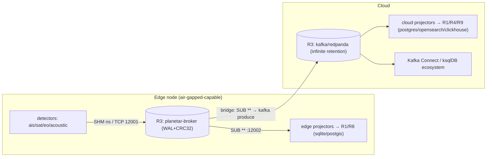

# 40 · Adapters — Stream / bus (R3)

**Role:** [R3 · stream](../10-STORAGE-ROLES.md#r3--stream-the-bus) — the ordered, durable, append-only log of **every** envelope (sensor readings *and* action effects *and* audit) plus fan-out. The nervous system; **all other stores are projections of it.**

**Port:** `Stream` from [`12-ADAPTER-CONTRACT.md §3`](../12-ADAPTER-CONTRACT.md) — `publish` / `subscribe` / `ack`.

**Engines in this file:** `planetar-broker` (native ns bus, default) · `kafka`/`redpanda` (Kafka ecosystem, infinite retention) · `redis-streams` (lightweight, ride an existing redis) · `NATS JetStream` (light, cloud-native, edge mesh).

> **The one non-rebuildable projection.** Every other role (R1, R4, R5, R7, R8, R9, R12 …) is `rebuildable: true` — drop it and re-derive it by replaying R3. R3 cannot be rebuilt because **it is the source.** This is why its `capabilities.consistency` is `append-only` and `rebuildable: false`, and why the manifest compiler refuses to bind it to a non-durable engine if any consumer needs replay ([`13 §2`](../13-CLIENT-MANIFEST.md)). The bus is the spine of record ([`00 §3` principle 2](../00-ARCHITECTURE-OVERVIEW.md)); losing it is the only data-loss event the architecture treats as unrecoverable.

---

## 1. Which engine, when

| You want… | Pick | Why |
|---|---|---|
| Lowest possible latency, edge/air-gapped, no external services | **planetar-broker** | ns SHM path; one ~1.2 k-LOC C binary; WAL+CRC32; runs offline |
| The Kafka ecosystem, infinite retention, consumer-group rebalancing, Connect/ksqlDB | **kafka / redpanda** | mature tooling; redpanda = same wire, no JVM/ZK |
| You already run redis (R2) and want a cheap durable log without a new system | **redis-streams** | XADD/XREADGROUP gives consumer groups + acks; collapse R2+R3 onto one engine |
| Light, cloud-native, request/reply + streams, edge-to-cloud mesh | **NATS JetStream** | tiny footprint, built-in mirroring/leaf-nodes for edge→cloud topology |

The headline topology (§7) runs **broker at the edge, bridged to kafka in the cloud** — two valid R3 bindings, one wire contract (`zmesg`). The envelope's `id` (UUIDv7), `correlationId`, and `causationId` are what make identity survive the hop.

### 1.1 The framing contract (load-bearing — do not paraphrase)

Verified against `~/github/planetarx/planetar-broker/planetar-broker.c` and `~/github/sness23/zmesg/zmesg.h`:

```
TCP frame on the wire (pub :12001 / sub :12002):
  ┌────────────────────────┬───────────────────────────────────────────┐
  │ u32 length  BIG-ENDIAN  │  zmesg envelope (66-byte hdr + vars), LE   │
  │ (network byte order)    │  magic 0x5A4D5347, all integer fields LE   │
  └────────────────────────┴───────────────────────────────────────────┘
SUB handshake (sub port, one line ≤1 KiB, ≤32 topics):
  "SUB <topic>[ <topic>]*\n"      — the special topic "**" matches every envelope
UDP (:12003): exactly one envelope per datagram, NO length prefix.
```

The mixed endianness is deliberate and **must** be honored: the 4-byte length prefix is `writeUInt32BE` / `readUInt32BE`; the envelope body (magic, `header_len`, all `*_len`, timestamps, `payload_len`) is little-endian. Topic matching uses the topic **inside** the envelope (offset 48 = `topic_len`, offset 66 = topic start), not the frame. (See `reference_broker_framing.md` for the latent `<I` LE-prefix bug this convention exists to prevent.)

---

## 2. Shared envelope codec (used by every adapter)

The four adapters all speak the same `Envelope`. The codec below is the TS port of `zmesg.h`, byte-identical to the production `~/github/planetarx/planetar-ui/bridge/zmesg.mjs` (built). Engines that have a native header (kafka, NATS) carry the **whole** envelope as the message value so identity is preserved verbatim; only the broker uses the 4-byte BE frame on the wire.

```ts
// 40-ADAPTERS/_shared/zmesg.ts  — mirrors ~/github/sness23/zmesg/zmesg.h (built)
export const ZMESG_MAGIC = 0x5a4d5347;   // "ZMSG", read little-endian
export const ZMESG_FIXED_HDR = 66;
export const ZMESG_VERSION = 1;

import type { Envelope, TopicPattern, Offset } from '../../spine/ports/stream';

const enc = new TextEncoder();
const dec = new TextDecoder();

function uuidToBytes(id: string): Uint8Array {
  const hex = id.replace(/-/g, '');
  if (hex.length !== 32) throw new Error(`bad uuid: ${id}`);
  const out = new Uint8Array(16);
  for (let i = 0; i < 16; i++) out[i] = parseInt(hex.slice(i * 2, i * 2 + 2), 16);
  return out;
}
function bytesToUuid(b: Uint8Array): string {
  const h = [...b].map((x) => x.toString(16).padStart(2, '0')).join('');
  return `${h.slice(0, 8)}-${h.slice(8, 12)}-${h.slice(12, 16)}-${h.slice(16, 20)}-${h.slice(20, 32)}`;
}
function payloadBytes(p: unknown): Uint8Array {
  if (p instanceof Uint8Array) return p;
  if (p == null) return new Uint8Array(0);
  return enc.encode(typeof p === 'string' ? p : JSON.stringify(p));
}

/** Serialize an Envelope to the LE zmesg byte layout (NO frame prefix). */
export function encodeEnvelope(env: Envelope): Uint8Array {
  const topic = enc.encode(env.topic);
  const source = enc.encode(env.source ?? '');
  const schema = enc.encode(env.schemaName ?? '');
  const corr = enc.encode(env.correlationId ?? '');
  const caus = enc.encode(env.causationId ?? '');
  const payload = payloadBytes(env.payload);
  if (topic.length > 256) throw new Error('topic exceeds 256 bytes');

  const headerLen = ZMESG_FIXED_HDR + topic.length + source.length + schema.length + corr.length + caus.length;
  const total = headerLen + payload.length;
  const buf = new Uint8Array(total);
  const dv = new DataView(buf.buffer);

  dv.setUint32(0, ZMESG_MAGIC, true);              // LE
  dv.setUint8(4, ZMESG_VERSION);
  dv.setUint8(5, env.flags ?? 0);
  dv.setUint16(6, headerLen, true);
  buf.set(uuidToBytes(env.id), 8);
  dv.setBigUint64(24, BigInt(env.createdAtNs), true);
  dv.setBigUint64(32, BigInt(env.storedAtNs ?? env.createdAtNs), true);
  dv.setBigUint64(40, BigInt(env.publishedAtNs ?? env.createdAtNs), true);
  dv.setUint16(48, topic.length, true);
  dv.setUint16(50, source.length, true);
  dv.setUint16(52, schema.length, true);
  dv.setUint16(54, corr.length, true);
  dv.setUint16(56, caus.length, true);
  dv.setUint32(58, env.schemaVersion ?? 1, true);
  dv.setUint32(62, payload.length, true);

  let o = ZMESG_FIXED_HDR;
  for (const f of [topic, source, schema, corr, caus, payload]) { buf.set(f, o); o += f.length; }
  return buf;
}

/** Parse the LE zmesg byte layout back to an Envelope (zero-copy on payload). */
export function decodeEnvelope(buf: Uint8Array): Envelope {
  if (buf.length < ZMESG_FIXED_HDR) throw new Error('envelope shorter than fixed header');
  const dv = new DataView(buf.buffer, buf.byteOffset, buf.byteLength);
  if (dv.getUint32(0, true) !== ZMESG_MAGIC) throw new Error('bad zmesg magic');

  const topicLen = dv.getUint16(48, true), sourceLen = dv.getUint16(50, true),
        schemaLen = dv.getUint16(52, true), corrLen = dv.getUint16(54, true),
        causLen = dv.getUint16(56, true), payloadLen = dv.getUint32(62, true);
  let o = ZMESG_FIXED_HDR;
  const take = (n: number) => { const s = buf.subarray(o, o + n); o += n; return s; };
  const topic = dec.decode(take(topicLen)), source = dec.decode(take(sourceLen)),
        schemaName = dec.decode(take(schemaLen)), correlationId = dec.decode(take(corrLen)),
        causationId = dec.decode(take(causLen)), payload = take(payloadLen);

  return {
    id: bytesToUuid(buf.subarray(8, 24)),
    flags: dv.getUint8(5),
    createdAtNs: dv.getBigUint64(24, true).toString(),
    storedAtNs: dv.getBigUint64(32, true).toString(),
    publishedAtNs: dv.getBigUint64(40, true).toString(),
    schemaVersion: dv.getUint32(58, true),
    topic, source, schemaName, correlationId, causationId,
    payload, // raw bytes; surfaces JSON.parse lazily
  };
}

/** TCP frame: prepend a 4-byte BIG-ENDIAN length (network byte order). */
export function frameTCP(envelope: Uint8Array): Uint8Array {
  const out = new Uint8Array(4 + envelope.length);
  new DataView(out.buffer).setUint32(0, envelope.length, false); // BE — the spine convention
  out.set(envelope, 4);
  return out;
}

/** Streaming de-framer for length-prefixed TCP. */
export class TCPFrameParser {
  private buf = new Uint8Array(0);
  push(chunk: Uint8Array, onFrame: (frame: Uint8Array) => void): void {
    this.buf = this.buf.length === 0 ? chunk : concat(this.buf, chunk);
    while (this.buf.length >= 4) {
      const len = new DataView(this.buf.buffer, this.buf.byteOffset).getUint32(0, false); // BE
      if (len === 0 || len > 16 * 1024 * 1024) { this.buf = new Uint8Array(0); return; }   // resync
      if (this.buf.length < 4 + len) break;
      onFrame(this.buf.subarray(4, 4 + len));
      this.buf = this.buf.subarray(4 + len);
    }
  }
}
function concat(a: Uint8Array, b: Uint8Array): Uint8Array {
  const out = new Uint8Array(a.length + b.length); out.set(a); out.set(b, a.length); return out;
}
```

The `Stream` port and its `Envelope` (the canonical shape every adapter exchanges):

```ts
// spine/ports/stream.ts — restated from 12-ADAPTER-CONTRACT.md §3
import type { Adapter } from './adapter';

export type TopicPattern = string;             // "vessel.ais.*" | "**" (broker glob)
export type Offset = string;                   // engine-opaque cursor (broker seq | kafka off | redis id | nats seq)

export interface Envelope {
  id: string;                                  // UUIDv7 — the identity that survives every hop
  topic: string;
  source?: string;
  schemaName?: string;
  schemaVersion?: number;
  correlationId?: string;                      // preserved across broker↔kafka bridge
  causationId?: string;                        // preserved across broker↔kafka bridge
  createdAtNs: string | bigint;                // ns since epoch
  storedAtNs?: string | bigint;
  publishedAtNs?: string | bigint;
  flags?: number;
  payload: unknown;                            // bytes on the wire; JSON/MsgPack at the edge
}

export interface DeliveredEnvelope extends Envelope { offset: Offset; }

export interface Stream extends Adapter {
  publish(env: Envelope): Promise<void>;                                   // append to the log + fan-out
  subscribe(topics: TopicPattern[], from: Offset | 'latest'): AsyncIterable<DeliveredEnvelope>;
  ack(offset: Offset): Promise<void>;
}
```

---

## 3. `planetar-broker` adapter (native ns bus · default)

A thin TS wrapper over the existing C broker's two TCP ports. **No new broker code** — it wraps the built binary at `~/github/planetarx/planetar-broker` exactly as `planetar-ui/bridge/server.mjs` and `planetar-ais/src/publisher.mjs` already do (both **built**). Status: **built** (wraps a built engine; this TS port is the new layer).

```ts
// 40-ADAPTERS/broker/stream.ts
import net from 'node:net';
import { v7 as uuidv7 } from 'uuid';
import type { AdapterContext, AdapterCapabilities, HealthStatus } from '../../spine/ports/adapter';
import type { Stream, Envelope, DeliveredEnvelope, TopicPattern, Offset } from '../../spine/ports/stream';
import { encodeEnvelope, decodeEnvelope, frameTCP, TCPFrameParser } from '../_shared/zmesg';

export class BrokerStream implements Stream {
  readonly capabilities: AdapterCapabilities = {
    consistency: 'append-only',
    durable: true,            // C broker WAL + CRC32
    rebuildable: false,       // THIS IS THE SOURCE — never re-derived
    scale: 'vertical',        // single ns broker per node; sharded via topic bridge (§7)
    p99TargetMs: 1,           // TCP path; SHM path is ns (sub-microsecond)
  } as const;

  private host = '127.0.0.1';
  private pubPort = 12001;
  private subPort = 12002;
  private producer!: net.Socket;
  private connected = false;

  async init(ctx: AdapterContext): Promise<void> {
    const c = ctx.manifest.config as { host?: string; pub?: number; sub?: number };
    this.host = c.host ?? this.host;
    this.pubPort = c.pub ?? this.pubPort;
    this.subPort = c.sub ?? this.subPort;
    await this.connectProducer();
  }

  private connectProducer(): Promise<void> {
    return new Promise((resolve, reject) => {
      this.producer = net.connect({ host: this.host, port: this.pubPort });
      this.producer.setNoDelay(true);                 // matches TCP_NODELAY on the C side
      this.producer.once('connect', () => { this.connected = true; resolve(); });
      this.producer.once('error', reject);
      this.producer.on('close', () => { this.connected = false; this.scheduleReconnect(); });
    });
  }
  private scheduleReconnect() { setTimeout(() => this.connectProducer().catch(() => {}), 2000); }

  /** Append to the log. Envelope serialized LE; wire frame is 4-byte BE length + body. */
  async publish(env: Envelope): Promise<void> {
    if (!this.connected) throw new Error('broker producer not connected');
    const now = String(BigInt(Date.now()) * 1_000_000n);
    const full: Envelope = {
      ...env,
      id: env.id ?? uuidv7(),                         // UUIDv7 = the cross-engine identity
      createdAtNs: env.createdAtNs ?? now,
      publishedAtNs: env.publishedAtNs ?? now,
    };
    const body = encodeEnvelope(full);
    await new Promise<void>((res, rej) =>
      this.producer.write(frameTCP(body), (e) => (e ? rej(e) : res())));   // frameTCP = BE prefix
  }

  /** Subscribe over the dedicated sub port with the `SUB <topics>\n` handshake. */
  async *subscribe(topics: TopicPattern[], _from: Offset | 'latest'): AsyncIterable<DeliveredEnvelope> {
    const sock = net.connect({ host: this.host, port: this.subPort });
    sock.setNoDelay(true);
    const parser = new TCPFrameParser();
    const queue: DeliveredEnvelope[] = [];
    let resume: (() => void) | null = null;
    let handshakeDone = false;
    let leftover = new Uint8Array(0);

    sock.on('connect', () => {
      // broker matches on the topic INSIDE the envelope; "**" matches all. Max 32 topics / 1 KiB.
      const line = `SUB ${(topics.length ? topics : ['**']).join(' ')}\n`;
      sock.write(line);
    });

    sock.on('data', (chunk: Buffer) => {
      let bytes: Uint8Array = chunk;
      if (!handshakeDone) {
        // broker replies with a status line ("OK ...\n" or an error) terminated by \n
        const merged = concat(leftover, bytes);
        const nl = merged.indexOf(0x0a);
        if (nl < 0) { leftover = merged; return; }
        const status = new TextDecoder().decode(merged.subarray(0, nl));
        if (!/^OK/i.test(status)) { sock.destroy(new Error(`SUB rejected: ${status}`)); return; }
        handshakeDone = true;
        bytes = merged.subarray(nl + 1);
        leftover = new Uint8Array(0);
      }
      parser.push(bytes, (frame) => {
        const env = decodeEnvelope(frame);
        // The broker's offset is the WAL sequence; we surface it for ack()/replay symmetry.
        queue.push({ ...env, offset: env.id });   // UUIDv7 is monotonic → usable as a stable cursor
        resume?.();
      });
    });

    sock.on('error', () => resume?.());
    sock.on('close', () => resume?.());

    try {
      while (sock.readable || queue.length) {
        if (queue.length === 0) await new Promise<void>((r) => (resume = r));
        while (queue.length) yield queue.shift()!;
      }
    } finally {
      sock.destroy();
    }
  }

  /** The broker is fire-and-forget at the TCP edge; durability is its WAL, not a consumer ack.
   *  Offsets are tracked by the projector's own checkpoint (R1), so ack is a no-op here. */
  async ack(_offset: Offset): Promise<void> { /* WAL-durable upstream; no broker-side ack protocol */ }

  async health(): Promise<HealthStatus> {
    return { ok: this.connected, detail: `broker ${this.host}:${this.pubPort}/${this.subPort}` };
  }
  async close(): Promise<void> { this.producer?.destroy(); }
}
function concat(a: Uint8Array, b: Uint8Array): Uint8Array {
  const out = new Uint8Array(a.length + b.length); out.set(a); out.set(b, a.length); return out;
}
```

> **SHM path.** The ns numbers come from the broker's Unix-socket SHM ring (`/tmp/planetar-broker.sock`, SCM_RIGHTS handshake). That path is C-to-C (detectors ↔ broker) and is not exposed to the TS adapter; this adapter wraps the **TCP** path (12001/12002), whose measured baseline is paced-TCP p50 34 µs / p99 ~424 µs (`project_planetar_broker_perf.md`). The `p99TargetMs: 1` is the contract the platform schedules against, comfortably above the measured TCP p99.

---

## 4. `kafka` / `redpanda` adapter (kafkajs)

Carry the **entire `zmesg` envelope as the Kafka message value** (so the bridge in §7 is byte-preserving), and lift identity fields into Kafka **headers** for cheap routing/filtering without decoding the value. Consumer groups give durable, rebalanced offsets; `ack` commits them. Status: **designed** (kafkajs is mature; no planetar deployment runs Kafka yet — broker is the built default).

```ts
// 40-ADAPTERS/kafka/stream.ts
import { Kafka, type Consumer, type Producer } from 'kafkajs';
import type { AdapterContext, AdapterCapabilities, HealthStatus } from '../../spine/ports/adapter';
import type { Stream, Envelope, DeliveredEnvelope, TopicPattern, Offset } from '../../spine/ports/stream';
import { encodeEnvelope, decodeEnvelope } from '../_shared/zmesg';

const TOPIC = 'planetar.envelopes';   // one Kafka topic; zmesg.topic stays in the header/value

export class KafkaStream implements Stream {
  readonly capabilities: AdapterCapabilities = {
    consistency: 'append-only',
    durable: true,
    rebuildable: false,            // source of record when Kafka IS the R3 binding
    scale: 'sharded',              // partitions; key = correlationId for per-entity ordering
    p99TargetMs: 5,
  } as const;

  private kafka!: Kafka;
  private producer!: Producer;
  private groupId!: string;

  async init(ctx: AdapterContext): Promise<void> {
    const c = ctx.manifest.config as { brokers: string[]; clientId?: string; groupId?: string };
    this.kafka = new Kafka({ clientId: c.clientId ?? 'planetar', brokers: c.brokers });
    this.groupId = c.groupId ?? 'planetar-projectors';
    this.producer = this.kafka.producer({ allowAutoTopicCreation: false, idempotent: true });
    await this.producer.connect();
  }

  async publish(env: Envelope): Promise<void> {
    const value = Buffer.from(encodeEnvelope(env));    // FULL zmesg envelope, unmodified
    await this.producer.send({
      topic: TOPIC,
      messages: [{
        // partition by correlationId → all events of one entity land in one partition, ordered
        key: env.correlationId || env.id,
        value,
        headers: {                                     // identity lifted out for routing, value untouched
          'z-id': env.id,
          'z-topic': env.topic,
          'z-correlation': env.correlationId ?? '',
          'z-causation': env.causationId ?? '',
          'z-schema': env.schemaName ?? '',
        },
      }],
    });
  }

  async *subscribe(topics: TopicPattern[], from: Offset | 'latest'): AsyncIterable<DeliveredEnvelope> {
    const consumer: Consumer = this.kafka.consumer({ groupId: this.groupId });
    await consumer.connect();
    await consumer.subscribe({ topic: TOPIC, fromBeginning: from !== 'latest' });

    const queue: DeliveredEnvelope[] = [];
    let resume: (() => void) | null = null;
    const want = compileMatchers(topics.length ? topics : ['**']);

    consumer.run({
      eachMessage: async ({ message, partition }) => {
        if (!message.value) return;
        const env = decodeEnvelope(message.value);      // identical bytes → identical Envelope
        if (!want(env.topic)) return;                   // server has one Kafka topic; filter zmesg.topic here
        queue.push({ ...env, offset: `${partition}:${message.offset}` });
        resume?.();
      },
    });

    while (true) {
      if (queue.length === 0) await new Promise<void>((r) => (resume = r));
      while (queue.length) yield queue.shift()!;
    }
  }

  /** Commit the consumer-group offset = durable progress. */
  async ack(offset: Offset): Promise<void> {
    // offset format "partition:offset"; in practice the projector batches commits.
    // kafkajs commits via consumer.commitOffsets — wired through the running consumer handle.
    void offset; /* see projector loop; commit is consumer-bound, batched */
  }

  async health(): Promise<HealthStatus> {
    const admin = this.kafka.admin(); await admin.connect();
    const meta = await admin.fetchTopicMetadata({ topics: [TOPIC] }).catch(() => null);
    await admin.disconnect();
    return { ok: !!meta, detail: `kafka ${TOPIC}` };
  }
  async close(): Promise<void> { await this.producer.disconnect(); }
}

/** glob "vessel.ais.*" / "**" → predicate over zmesg.topic (matches broker semantics). */
export function compileMatchers(patterns: TopicPattern[]): (topic: string) => boolean {
  if (patterns.includes('**')) return () => true;
  const res = patterns.map((p) =>
    new RegExp('^' + p.replace(/[.]/g, '\\.').replace(/\*\*/g, '.*').replace(/\*/g, '[^.]+') + '$'));
  return (t) => res.some((r) => r.test(t));
}
```

---

## 5. `redis-streams` adapter (ioredis · XADD/XREADGROUP)

Collapses R2+R3 onto one redis when a client already runs it (`11 §3` CRM-only footprint). One stream per node; `zmesg.topic` carried as a field; consumer groups + `XACK` give at-least-once with explicit ack. Status: **designed**.

```ts
// 40-ADAPTERS/redis-streams/stream.ts
import Redis from 'ioredis';
import type { AdapterContext, AdapterCapabilities, HealthStatus } from '../../spine/ports/adapter';
import type { Stream, Envelope, DeliveredEnvelope, TopicPattern, Offset } from '../../spine/ports/stream';
import { encodeEnvelope, decodeEnvelope } from '../_shared/zmesg';
import { compileMatchers } from '../kafka/stream';

const KEY = 'planetar:stream';   // a single Redis stream key; topic filtering is in-adapter

export class RedisStream implements Stream {
  readonly capabilities: AdapterCapabilities = {
    consistency: 'append-only',
    durable: true,                 // requires AOF appendfsync everysec/always (checked in init)
    rebuildable: false,
    scale: 'vertical',
    p99TargetMs: 3,
  } as const;

  private redis!: Redis;
  private group!: string;
  private consumerName!: string;

  async init(ctx: AdapterContext): Promise<void> {
    const c = ctx.manifest.config as { url: string; group?: string; consumer?: string };
    this.redis = new Redis(c.url);
    this.group = c.group ?? 'projectors';
    this.consumerName = c.consumer ?? `c-${process.pid}`;
    // Durability self-check: R3 cannot bind to a non-durable engine (10 §1).
    const cfg = await this.redis.config('GET', 'appendonly');
    if (cfg[1] !== 'yes') throw new Error('redis-streams R3 requires appendonly=yes (durable contract)');
    await this.redis.xgroup('CREATE', KEY, this.group, '$', 'MKSTREAM').catch((e) => {
      if (!String(e).includes('BUSYGROUP')) throw e;   // group already exists — fine
    });
  }

  async publish(env: Envelope): Promise<void> {
    const body = Buffer.from(encodeEnvelope(env)).toString('base64');
    // XADD * = server-assigned monotonic id (ms-seq) = the offset.
    await this.redis.xadd(KEY, '*', 'topic', env.topic, 'id', env.id, 'body', body);
  }

  async *subscribe(topics: TopicPattern[], from: Offset | 'latest'): AsyncIterable<DeliveredEnvelope> {
    const want = compileMatchers(topics.length ? topics : ['**']);
    const start = from === 'latest' ? '>' : '0';   // '>' = only new, undelivered to this group
    let cursor = start;
    while (true) {
      const res = await this.redis.xreadgroup(
        'GROUP', this.group, this.consumerName, 'COUNT', 256, 'BLOCK', 5000,
        'STREAMS', KEY, cursor,
      ) as [string, [string, string[]][]][] | null;
      if (!res) continue;
      for (const [, entries] of res) {
        for (const [streamId, fields] of entries) {
          const f = Object.fromEntries(chunkPairs(fields));
          const env = decodeEnvelope(Buffer.from(f.body, 'base64'));
          // backlog replay (cursor !== '>') advances the cursor; live mode stays at '>'
          if (cursor !== '>') cursor = streamId;
          if (want(env.topic)) yield { ...env, offset: streamId };
        }
      }
      if (cursor !== '>' && res[0]?.[1].length === 0) cursor = '>';   // backlog drained → go live
    }
  }

  /** XACK removes the entry from this group's pending-entries-list. */
  async ack(offset: Offset): Promise<void> { await this.redis.xack(KEY, this.group, offset); }

  async health(): Promise<HealthStatus> {
    const pong = await this.redis.ping().catch(() => null);
    return { ok: pong === 'PONG', detail: `redis-streams ${KEY}/${this.group}` };
  }
  async close(): Promise<void> { this.redis.disconnect(); }
}
function* chunkPairs(a: string[]): Iterable<[string, string]> {
  for (let i = 0; i < a.length; i += 2) yield [a[i], a[i + 1]];
}
```

---

## 6. `NATS JetStream` adapter (nats.js)

Tiny footprint, native edge↔cloud mirroring (leaf nodes), durable consumers with explicit ack. Carries the full envelope as the message payload. Status: **designed**.

```ts
// 40-ADAPTERS/nats/stream.ts
import { connect, type NatsConnection, type JetStreamClient, AckPolicy } from 'nats';
import type { AdapterContext, AdapterCapabilities, HealthStatus } from '../../spine/ports/adapter';
import type { Stream, Envelope, DeliveredEnvelope, TopicPattern, Offset } from '../../spine/ports/stream';
import { encodeEnvelope, decodeEnvelope } from '../_shared/zmesg';

const STREAM = 'PLANETAR';
const SUBJECT_ROOT = 'planetar';   // zmesg.topic → NATS subject "planetar.<dotted.topic>"

export class NatsStream implements Stream {
  readonly capabilities: AdapterCapabilities = {
    consistency: 'append-only',
    durable: true,                 // JetStream file storage
    rebuildable: false,
    scale: 'sharded',              // subject-based; mirrors/sources for edge→cloud
    p99TargetMs: 4,
  } as const;

  private nc!: NatsConnection;
  private js!: JetStreamClient;

  async init(ctx: AdapterContext): Promise<void> {
    const c = ctx.manifest.config as { servers: string | string[] };
    this.nc = await connect({ servers: c.servers });
    this.js = this.nc.jetstream();
    const jsm = await this.nc.jetstreamManager();
    await jsm.streams.add({ name: STREAM, subjects: [`${SUBJECT_ROOT}.>`] }).catch(() => {});
  }

  async publish(env: Envelope): Promise<void> {
    const subject = `${SUBJECT_ROOT}.${env.topic}`;   // NATS subjects are dotted — zmesg topics already are
    await this.js.publish(subject, encodeEnvelope(env), {
      msgID: env.id,                                  // JetStream dedupe keyed on UUIDv7 → idempotent publish
    });
  }

  async *subscribe(topics: TopicPattern[], from: Offset | 'latest'): AsyncIterable<DeliveredEnvelope> {
    const filter = topics.length
      ? topics.map((t) => `${SUBJECT_ROOT}.${t.replace(/\*\*/g, '>').replace(/\*/g, '*')}`)
      : [`${SUBJECT_ROOT}.>`];
    const sub = await this.js.subscribe(filter[0], {
      config: {
        ack_policy: AckPolicy.Explicit,
        deliver_policy: from === 'latest' ? undefined : undefined, // 'all' for replay; omitted = new
        filter_subjects: filter,
      },
    });
    for await (const m of sub) {
      const env = decodeEnvelope(m.data);
      yield { ...env, offset: String(m.seq) };
      // ack is explicit via ack(offset) — but JetStream acks the message handle, so we ack inline:
      m.ack();
    }
  }

  async ack(_offset: Offset): Promise<void> { /* JetStream ack is on the message handle (acked in subscribe) */ }

  async health(): Promise<HealthStatus> {
    return { ok: !this.nc.isClosed(), detail: `nats ${STREAM}` };
  }
  async close(): Promise<void> { await this.nc.drain(); }
}
```

---

## 7. Topology: broker at the edge, bridged to kafka in the cloud

This is the manifest diff in [`13 §3`](../13-CLIENT-MANIFEST.md) (`bridgeTo: kafka`) made concrete. Detectors publish onto the ns broker at the edge node; a one-way **bridge** subscribes `SUB **` on 12002 and re-publishes each envelope verbatim into Kafka. **Both are R3 bindings; the envelope is the wire contract across both.**



The bridge is just a `BrokerStream.subscribe` feeding a `KafkaStream.publish` — no envelope mutation:

```ts
// 40-ADAPTERS/broker/bridge-to-kafka.ts  (the edge→cloud R3 bridge)
import { BrokerStream } from './stream';
import { KafkaStream } from '../kafka/stream';

export async function bridgeBrokerToKafka(broker: BrokerStream, kafka: KafkaStream): Promise<void> {
  for await (const env of broker.subscribe(['**'], 'latest')) {
    // env.id / correlationId / causationId / createdAtNs are byte-preserved through encode/decode.
    await kafka.publish(env);          // FULL zmesg envelope → Kafka value; identity intact
    await broker.ack(env.offset);      // broker ack is a no-op; WAL already durable
  }
}
```

**Why identity survives the hop.** Both engines move the *same `zmesg` bytes*. The broker frames them with a 4-byte BE prefix on TCP; Kafka puts the identical body in the message **value** and copies `id`/`correlationId`/`causationId` into headers for routing. A cloud consumer that `decodeEnvelope`s the Kafka value gets the **same `UUIDv7` `id`** the edge detector minted — so an Observation projected at the edge and the same Observation projected in the cloud resolve to one `CanonicalEntity` (P5) with no de-dup ambiguity. Ordering per entity is preserved because Kafka is keyed on `correlationId`. The bridge is **one-way and lossless**; if the link drops, the broker WAL holds the backlog and the bridge replays from its last checkpoint (`from` offset), exactly the R3 replay contract.

---

## 8. Comparison

| Engine | Consistency | Scale | p99 (target / measured) | When to choose |
|---|---|---|---|---|
| **planetar-broker** | append-only, ordered per topic | vertical (1 broker/node; sharded via topic bridge) | 1 ms target · TCP measured p50 34 µs / p99 ~424 µs · **SHM ns path** | Edge, air-gapped, lowest latency, zero external deps; the default |
| **kafka / redpanda** | append-only, ordered per partition (key=correlationId) | sharded (partitions) | ~5 ms target | Kafka ecosystem, infinite retention, consumer groups, Connect/ksqlDB; cloud side of the bridge |
| **redis-streams** | append-only, ordered per stream | vertical | ~3 ms target | Already running redis (R2); collapse R2+R3; light durable log (needs `appendonly=yes`) |
| **NATS JetStream** | append-only, ordered per subject | sharded (subjects; mirrors) | ~4 ms target | Light cloud-native mesh; native edge→cloud mirroring without a custom bridge |

All four declare `consistency: 'append-only'`, `durable: true`, `rebuildable: false` — the R3 contract from [`10 §2`](../10-STORAGE-ROLES.md). The compiler rejects any R3 binding whose `durable` is false when a consumer needs replay; that is why an in-process queue can never fill R3 ([`13 §2`](../13-CLIENT-MANIFEST.md)).

---

## 9. Conformance-suite hookup

Every Stream adapter passes the **same** engine-agnostic suite ([`12 §5`](../12-ADAPTER-CONTRACT.md) pattern). Green across the matrix = a client can bind any engine to R3 and the spine behaves identically.

```ts
// 40-ADAPTERS/_conformance/stream.spec.ts
import type { Stream, Envelope } from '../../spine/ports/stream';
import { v7 as uuidv7 } from 'uuid';

function sampleEnvelope(over: Partial<Envelope> = {}): Envelope {
  const now = String(BigInt(Date.now()) * 1_000_000n);
  return {
    id: uuidv7(), topic: 'vessel.ais.position', source: 'conformance',
    schemaName: 'ais.position', schemaVersion: 1,
    correlationId: 'mmsi-316001234', causationId: '',
    createdAtNs: now, payload: { lat: 48.42, lon: -123.37, sog: 12.1 }, ...over,
  };
}

export function streamConformance(make: () => Stream) {
  test('round-trips an envelope: published bytes decode to the same identity', async () => {
    const s = make(); await s.init(testCtx());
    const sent = sampleEnvelope();
    const it = s.subscribe(['vessel.ais.*'], 'latest')[Symbol.asyncIterator]();
    await new Promise((r) => setTimeout(r, 50));   // let the subscribe handshake settle
    await s.publish(sent);
    const { value: got } = await it.next();
    expect(got!.id).toBe(sent.id);                              // UUIDv7 identity preserved
    expect(got!.correlationId).toBe(sent.correlationId);        // bridge-critical fields preserved
    expect(got!.topic).toBe(sent.topic);
    await s.close();
  });

  test('topic filter excludes non-matching topics', async () => {
    const s = make(); await s.init(testCtx());
    const it = s.subscribe(['vessel.ais.*'], 'latest')[Symbol.asyncIterator]();
    await new Promise((r) => setTimeout(r, 50));
    await s.publish(sampleEnvelope({ topic: 'sat.detection' }));   // must NOT be delivered
    await s.publish(sampleEnvelope({ topic: 'vessel.ais.position' }));
    const { value } = await it.next();
    expect(value!.topic).toBe('vessel.ais.position');
    await s.close();
  });

  test('declares capabilities that satisfy the R3 contract', () => {
    const c = make().capabilities;
    expect(c.consistency).toBe('append-only');
    expect(c.durable).toBe(true);
    expect(c.rebuildable).toBe(false);    // R3 is the source — NEVER rebuildable
  });

  test('replay from offset re-delivers prior envelopes (durability)', async () => {
    const s = make(); await s.init(testCtx());
    const sent = sampleEnvelope();
    await s.publish(sent);
    const it = s.subscribe(['vessel.ais.*'], '0' as any)[Symbol.asyncIterator]();  // from beginning
    const { value } = await it.next();
    expect(value!.id).toBe(sent.id);
    await s.close();
  });
}

// then, per engine:
//   streamConformance(() => new BrokerStream());
//   streamConformance(() => new KafkaStream());
//   streamConformance(() => new RedisStream());
//   streamConformance(() => new NatsStream());
// (BrokerStream + a live broker process; the rest behind testcontainers.)
```

The `replay from offset` test is the one R3-specific addition over other ports' suites: because R3 is the source of record, **durable replay is part of its contract**, and an engine that can't replay (e.g. plain redis pub/sub, or NATS core without JetStream) fails it and is therefore *not* a legal R3 binding.

---

## 10. Which manifest tiers / clients use which

| Tier / client | R3 engine(s) | Rationale |
|---|---|---|
| **edge** (`planetar-maritime`, air-gapped) | `broker` only | Zero external services; ns SHM path; WAL durability. The built default ([`13 §1`](../13-CLIENT-MANIFEST.md)). |
| **scale** (`planetar-maritime` regional) | `broker` at edge **→ bridged to** `kafka` in cloud | Keep ns ingest at the edge; infinite retention + ecosystem in cloud; one wire contract ([`13 §3`](../13-CLIENT-MANIFEST.md)). |
| **standard** (generic enterprise CRM+ops) | `redis-streams` (collapse R2+R3) or `redpanda` | CRM footprint `{R1,R10,R4,R9,R14,R3,R11}` collapses to postgres+redis+broker; redis already present ([`11 §3`](../11-CAPABILITY-ROLE-MAP.md)). |
| **scale / regulated** (intel / financial-crime) | `kafka` for R3 **+** R11 audit | Kafka doubles as the R11 audit sink streamed to SIEM ([`10 §2` R11](../10-STORAGE-ROLES.md)); consumer groups for many analytics consumers. |
| **biotech CRM** (`doibio`) | `broker` or `redis-streams` | doibio is event-sourced today (vault→SQLite); R3 binding feeds the same projector pattern. |

**Cross-role note.** R3 is also the durable substrate other roles lean on: R11 (audit-log) can bind `kafka` and *be the same stream* tee'd to a SIEM; R14 (work-queue) can bind `kafka`; R12 (lineage) edges are themselves envelopes on R3. Because every store is a projection of R3 ([`00 §3`](../00-ARCHITECTURE-OVERVIEW.md)), swapping any *other* role's engine is a re-projection from R3 — which is precisely why R3 itself is the one binding you can never swap without data migration, and the one the architecture protects with the WAL.
